# BG: A Benchmark to Evaluate Interactive Social Networking Actions
> Week 6: [CIDR13_Paper93.pdf](https://www.cidrdb.org/cidr2013/Papers/CIDR13_Paper93.pdf)

## Background and Goals

**BG benchmark**: Designed for comparing the **data stores** for a **social network application** (either read or update a very small amount of the entire dataset).

**What does BG benchmark assess?**

* Throughput
* Response time and confidence for a fixed response time (e.g. 90% of the request will respond within ...)
* Amount of unpredictable data
* Freshness confidence for a fixed duration (e.g. (95% of requests observe the freshest value in less than 10 seconds after an update occurs)

--> Rating metrics: SoAR, Socialites

> For social network applications,  we don't need (strict/immediate) consistency, but availability is important.

### CAP Theorem

A multi-node system may provide two out of three of the following guarantees at any given time.

* **Consistency**: A read request observes the most recent write or an error.
* **Availability**: A request observes a non-error response, even when nodes have failed.
* **Partition tolerance**: The system continues to operate despite the nodes not being able to communicate with one another, e.g., node failures, loss of an arbitrary number of messages between nodes for an arbitrary duration of time.

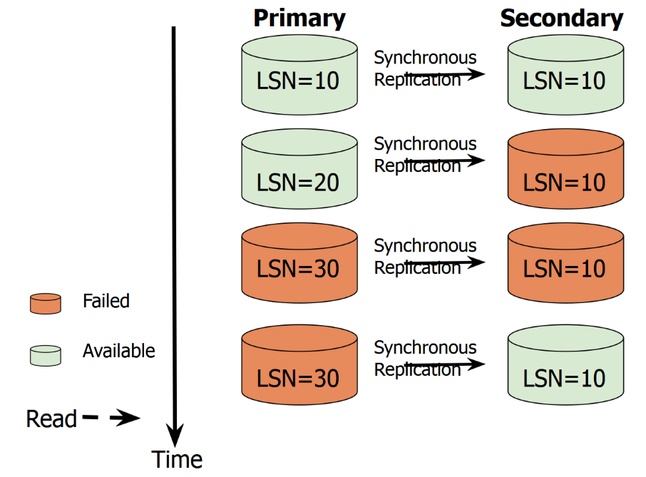

* If the secondary processes the read request, the system has chosen Availability instead of Consistency.
* If you want to prioritize Consistency, when the first node in the system fails, no more writes should be permitted.

### Eventually Consistent Read

When issuing eventually consistent reads to a DynamoDB table or an index, the responses might not reflect the results of a **recently completed** write operation. If you repeat your read request after a short time, the response should **eventually return the more recent item**.

--> Not suitable for financial applications, which should switch to strictly consistent read.

## Key Concepts

* **Service Level Agreement (SLA)**:  An SLA requires at least **α percentage** of requests to observe a **response time equal to or faster than β** with the amount of **unpredictable data less than τ** for some fixed **duration** of time Δ. 

  * e.g. an SLA might require 95% (α=95%) of actions to be performed faster than 100 msec (β=0.1 second) with no more than 0.1% (τ=0.1%) unpredictable data for 1 hour (Δ=3600 seconds)

* **Social Action Rating (SoAR)**: SoAR pertains to **the highest throughput** (actions per second) of a data store that satisfies this SLA.

  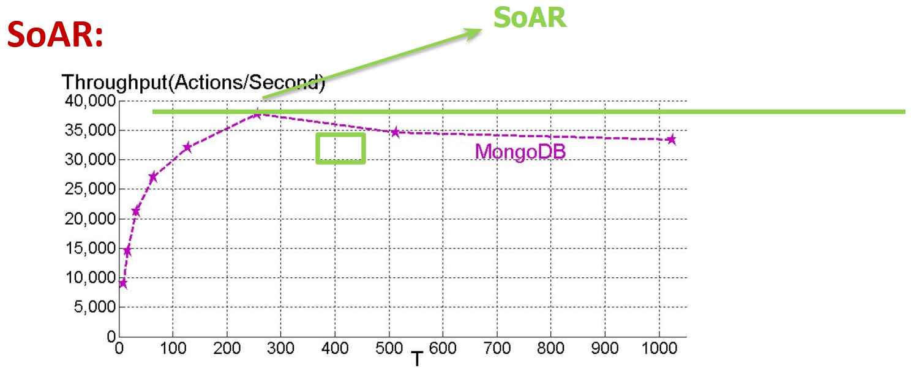

* **Socialites**: Socialites is **the highest number of threads** (largest T value) that satisfies this SLA.

  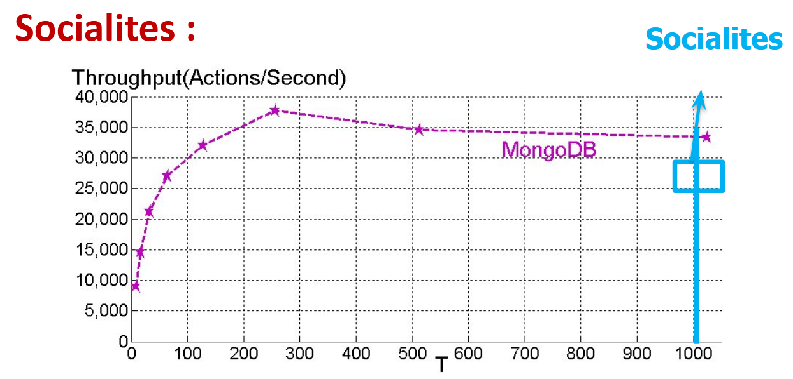

## BG Architecture and Implementation

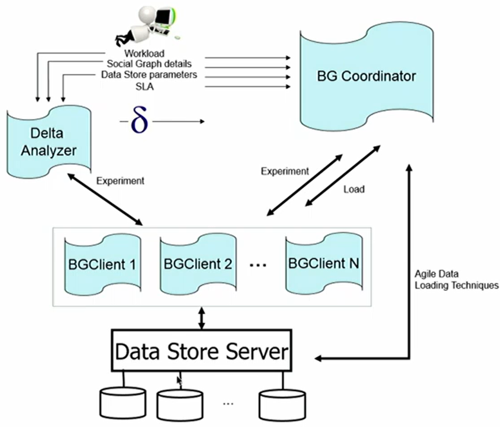

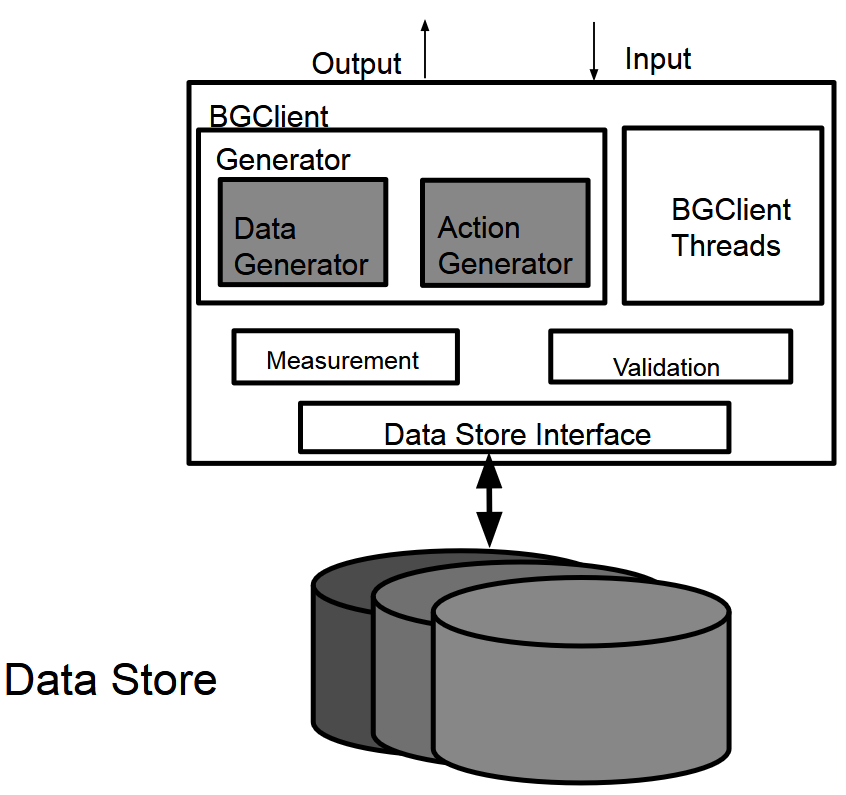

* Shared-nothing architecture
* BGCoord: 
  * Compute **SoAR and Socialites** **rating** of a data store, report results to BG's visualization deck
  * Compute the fraction of **workload** that should be issued by each worker process (BGClient) and communicates it with that BGClient
* BGClient:
  * Create a database
  * **Generate** a workload for the data store (consistent with the BGCoord's specifications)
  * **Compute the amount of unpredictable data**
* BG visualization deck

### Scalability

* Each BGClient has **a partition of the data**, and BGCoord is responsible for managing the partition. At the beginning, BGCoord launch BGClients. After clients produce their results, BGCoord combines the results and output the overall ratings.
* Can support a heterogeneous mix of servers with different processing capabilities.
* Each BGClient emulates a socialite who issues requests serially.

**Why scalability?** -- A scalable architecture is required to produce valid ratings.

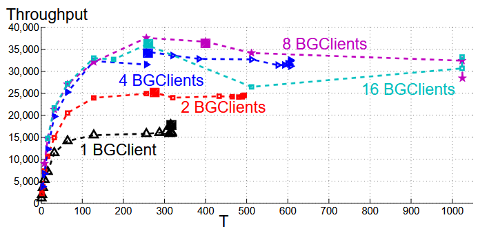

* When there's only one BGClient, it levels off at a very early stage, where **the CPU of the client server** becomes the bottleneck.
* Where there're 8-16 servers, the bottleneck is **the CPU of the database**. That's when we can get the true performance of the data storage system.

### Validation of Unpredictable Data

BG is aware of the initial state and new  state of the database. It can use the read and write log records to enumerate the finite way for a read action to overlap the writes, then decide whether the produced value is reasonable or not.

Validation is expensive -> offline validation after the experiment completes

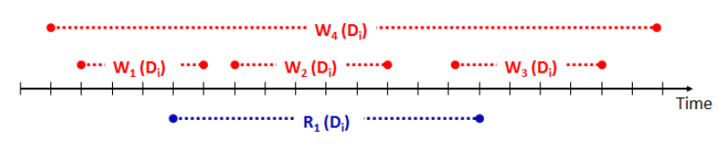

### Cache & Unpredictable Data

> TTL: time to live, time before cache data gets expired

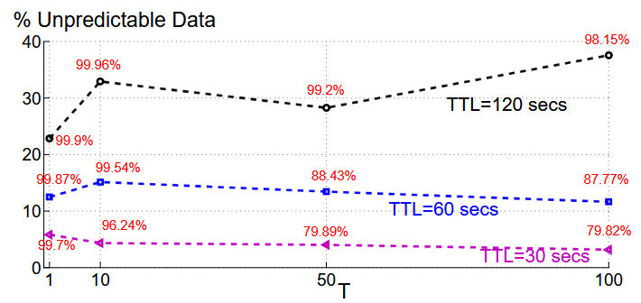

* For shorter TTL: cache expires sooner -> the percentage of missing increases -> more visit to DB (less unpredictable data)
* For longer TTL: percentage of unpredictable data decreases, but the requests that satisfy SLA also decrease (need more time to process the requests if cache misses)
* Why one thread can also produce unpredictable data?
  * A thread might first emulate a user editing his profile page, then emulates another user viewing this page. At that time, unpredictable data can appear.
  * But with the increase of TTL, the value (where T=1) doesn't change much. Because the system is sitting idle. Cache is unimportant at this stage.

### Quick Rating

**How to find the number of threads where throughput is the highest? (how to get SoAR)**

--> **Heuristic search**: Test with T=1, 2, 4, 8, 16, ... (like binary search)

Problem: Repeated construction and destruction of database is time consuming --> **Two agile data loading**:

* **Database Image Loading (DBIL)**
  * Create disk image of the DB
  * At the end of each experiment, destroy the DB, copy the disk image back, and run another experiment.
* RepairDB
  * Restores the database to its original state prior using the log records

## Actions and Performance

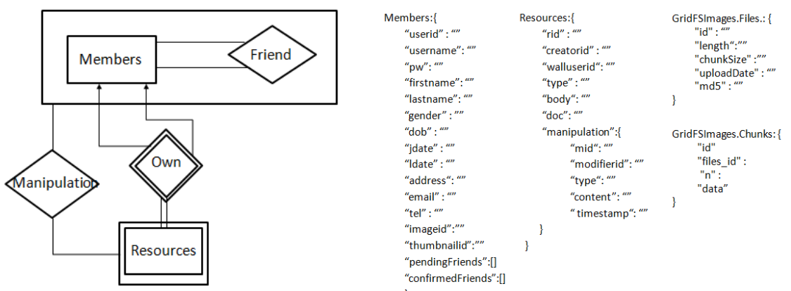

### View Profiles (VP)

Input: The socialite's id and the id of the referenced member $U_r$

Output: The profile information of $U_r$ --> $U_r$'s number of friends, $U_r$'s number of resources (e.g. images), $U_r$'s number of pending friend invitations (if viewing one's own profile)

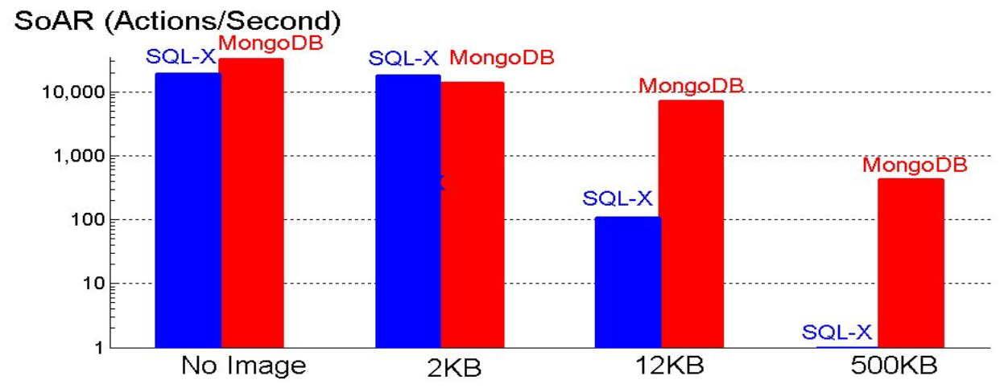

* Image size matters
* Why MongoDB's SoAR decreases with the increase of image size: It must transmit a larger amount of data to the BGClient using the network (bottleneck: server network)
* Why SQL-X decreases dramatically: Disk I/Os and the CPU of the server becomes the bottleneck
* How to accelerate SQL-X with large image size: Database only store the URI for the images -> return this URI to the client's side -> the client uses this URI to pull image (increased network time cost)

### List Friends (LF)

Retrieve the profile information of each friend (in the presence of images, it retrieves only the thumbnail image).

With image:

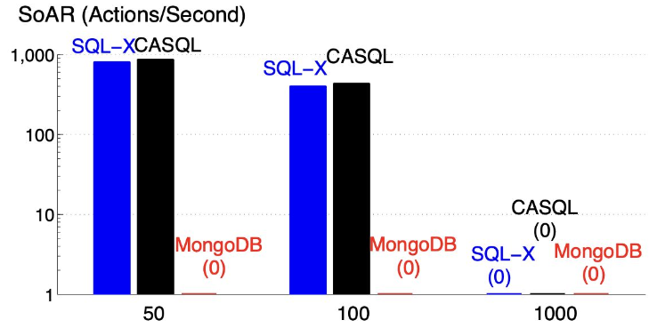

Without image:

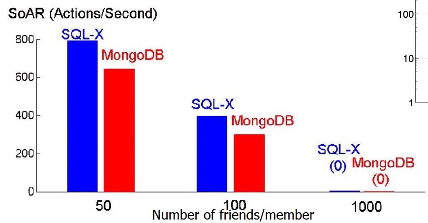

* Why CASQL doesn't work  in 1000: CASQL is unable to support key-value that is larger than 1MB, due to its limited memory size -> redirecting all requests issued by CASQL to SQL
* Why MongoDB is zero (with image): Instead of doing relational calculation, MongoDB needs to retrieve the confirmed-friends array and then retrieve the friends' profile documents --> cannot meet with SLA

### Mix of Reads and Writes

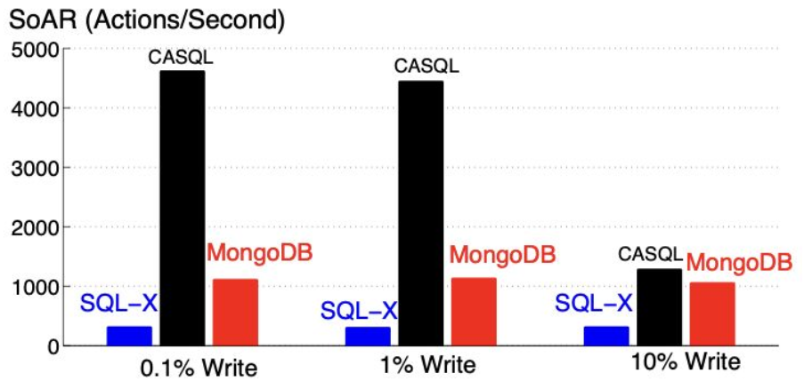

* MongoDB needs to wait for response from the server for write requests
* Having more writes -> the benefit of cache decreases

