# CAMP: A Cost Adaptive Multi-Queue Eviction Policy for Key-Value Stores

> Week 10: [CAMP: A Cost Adaptive Multi-Queue Eviction Policy for Key-Value Stores](https://arxiv.org/html/2411.01246v1#:~:text=Cost Adaptive Multi-queue eviction Policy (CAMP) is an,sizes%2C and varying costs for each key-value pair.)

CAMP is a memory management technique that considers **cost, size, and recency of references** to key-value pairs.

## Background

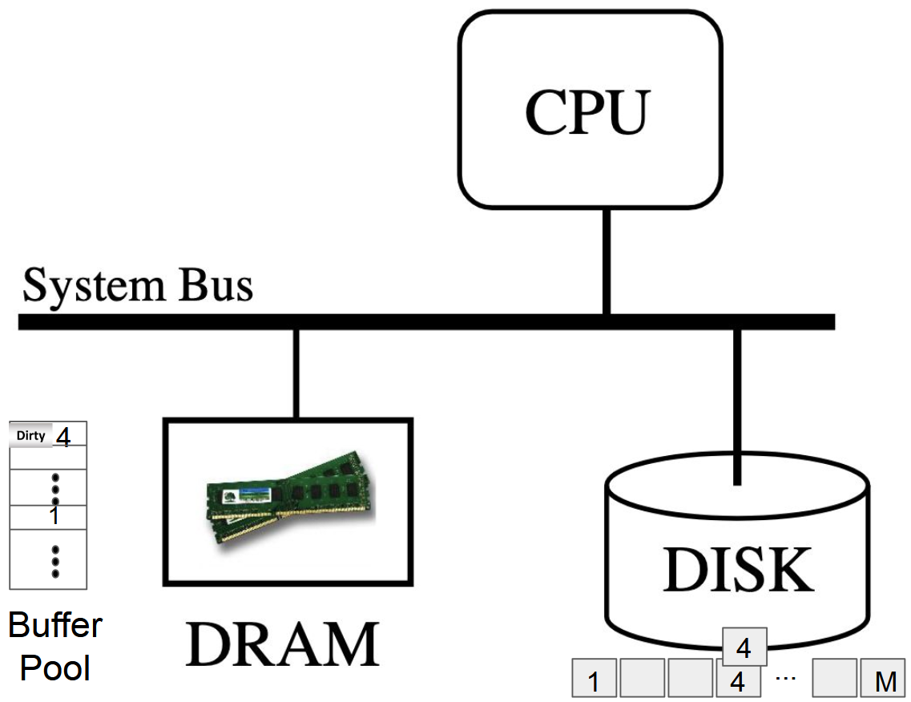

To process data fast, the DBMS reads disk pages into fixed-size **frames** in a DRAM buffer pool and keeps a **hash table** that maps each page ID to its frame address. Because the buffer pool has far fewer frames than there are pages on disk (F ≪ M), memory fills up quickly, and the system must evict an existing page (a **victim**) to make room for a new one.

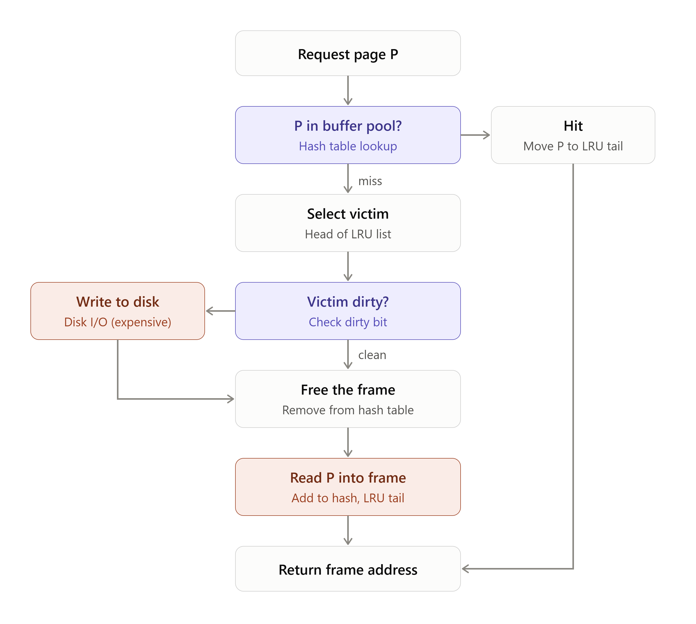

**Step 1: Look up P**

- Use the hash table (page ID → frame).
- On a **hit**, update P’s recency and return its frame address. There is no eviction.

**Step 2: Select a victim (on a miss with a full pool)**

- The **replacement policy** decides which page to evict. LRU evicts the page *not accessed for the longest time*.
- If a frame is already on the **free list**, use it directly and skip eviction.

**Step 3: Handle a dirty victim**

- If the victim is **dirty**, it must be **written back to disk first**. Otherwise the update is lost.
- This write is a full disk I/O, the most expensive part of eviction.
- A **clean** victim needs no write, because its disk copy is already up to date.

**Step 4: Free the frame**

- Remove the victim from the **in-memory hash table**.
- Either hand the frame directly to P or place it on the **free list**.

**Step 5: Read P in**

- Read P from disk into the freed frame. This is another disk I/O.
- Insert P into the hash table and set its recency (LRU tail / current timestamp).

**Step 6: Return to the caller**

- The buffer pool manager returns the **frame address** to the process that faulted: “here is your page, go use it.”

### Least Recently Used (LRU)

When the buffer pool is full and a new buffer page is required, the buffer pool manager evicts the page that has not been accessed for the longest time.

-> Cons: Too expensive. O(F) complexity.

**[Fast Implementation of LRU]**

1. A doubly linked list of elements. Each element identifies a page k.

2. Every time a page is referenced, move the page to the end of the list.
3. Victim is always the head of the list.
4. Visiting a certain page can be executed with the help of a hash table -> no need to go through the table.

**[LRU-K]**

The victim page is the one whose backward K-distance is the maximum of all pages in buffer.

**bt(p, K)**: Given a reference string known up to time t (r1, r2, …,rt), the backward distance bt(p,K) is the distance backward to the Kth most recent reference to page p.

**Cons of LRU**: Only take *time of last reference* into consideration -> Missing factors: size & cost of key-value pairs

### Cache Augmented Data Stores

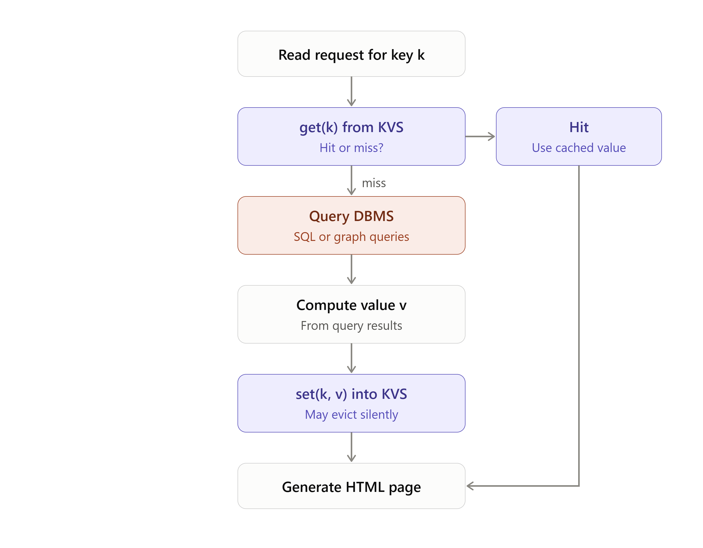

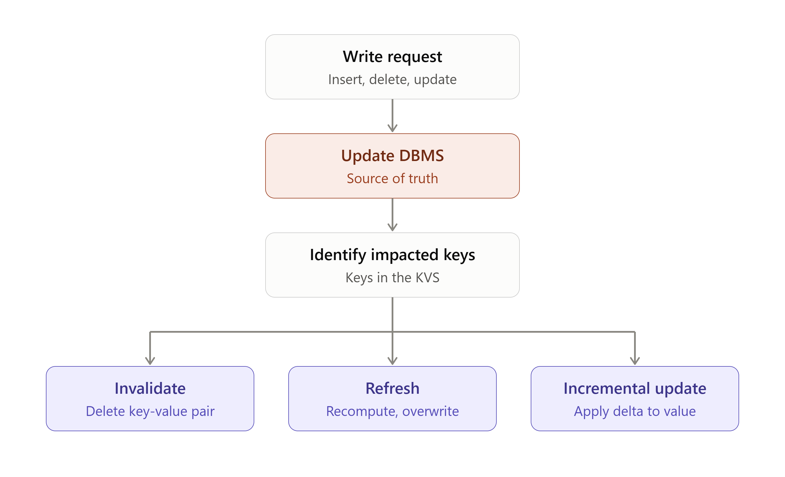

### Human Tuning (Pooled LRU)

**Problem:** Key-value pairs have very different costs and sizes, but LRU looks only at recency, so cheap hot items evict expensive ones.

**Solution:** An admin groups key-value pairs by cost and size, splits memory into pools, and runs LRU in each pool.

> Use cost per byte: Cost/Size

**Limitations:**

- Hard to group and tune by hand.
- Can’t adapt to changing workloads.
- Divides resources, which creates hot spots.

## Algorithm

### GreedyDualSize

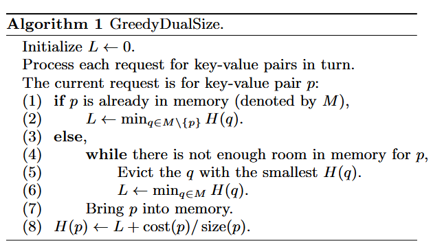

- **H(p)** is the priority of key-value pair p, an estimate of how valuable it is to keep in memory. The lowest H gets evicted first.
- **cost(p)/size(p)** is the cost per byte. Expensive or small items get a higher H and stay longer.
- L is a global “inflation” value that  only increases (non-decreasing).
  - Each new **H = L + cost/size**, so items not referenced recently fall behind newer ones. This is how recency is built in.
- **Hit (lines 1–2):** L is raised to the smallest H among the *other* items. Then line 8 refreshes p’s priority.
- **Miss (lines 3–7):** evict the item with the smallest H, and raise L to the new minimum H in memory. Repeat until p fits; it is a **while** loop because sizes vary, so one eviction may not free enough space. Then bring p in.
- **Line 8** runs on both hits and misses: H(p) ← L + cost(p)/size(p).
- **Invariant:** L ≤ H(p) ≤ L + cost(p)/size(p).
- A key-value p with cost(p)/size(p) ratio that is c time that of another key-value pair q will remain in the cache c times longer than q.

**Implementation -- priority queue**

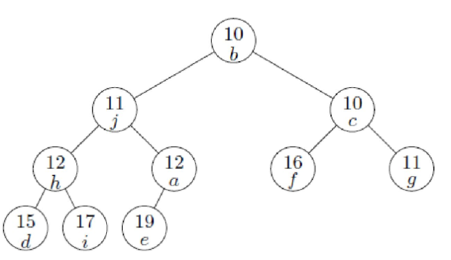

- **Huge heap:** the heap holds every key-value pair in the cache, which can be trillions of entries at Facebook scale.
- **Expensive updates:** each heap operation costs O(log n), and GDS updates the heap on **every hit**.
- **Not multicore-friendly:** a heap is inherently single-threaded, so concurrent updates need costly synchronization.

### CAMP Design

#### Approximation

CAMP rounds the priority for every key-value pair by rounding its cost/size ratio before adding it to L.

* This results in **a smaller set of possible cost/size values**. Organize the key-value pairs with the same cost/size values in an LRU queue.
* Maintain priority across the LRU queues using a heap. Evict from the LRU queue with the lowest priority.

#### Data Structure

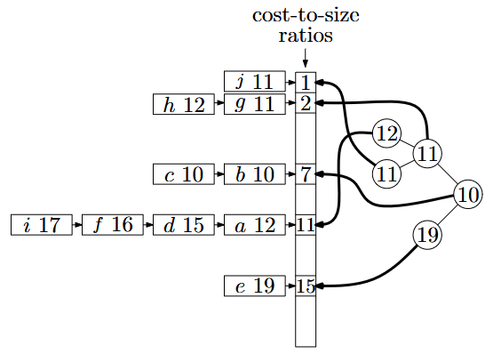

* One LRU queue for each cost/size ratio.
* When a key-value is referenced, CAMP adjusts its priority and moves it to the tail of the LRU queue.
* If key-value pairs within each queue are stored according to LRU then the key-value pairs are automatically ordered according to their priority.

#### Operations

**Hit for g with L=10:**

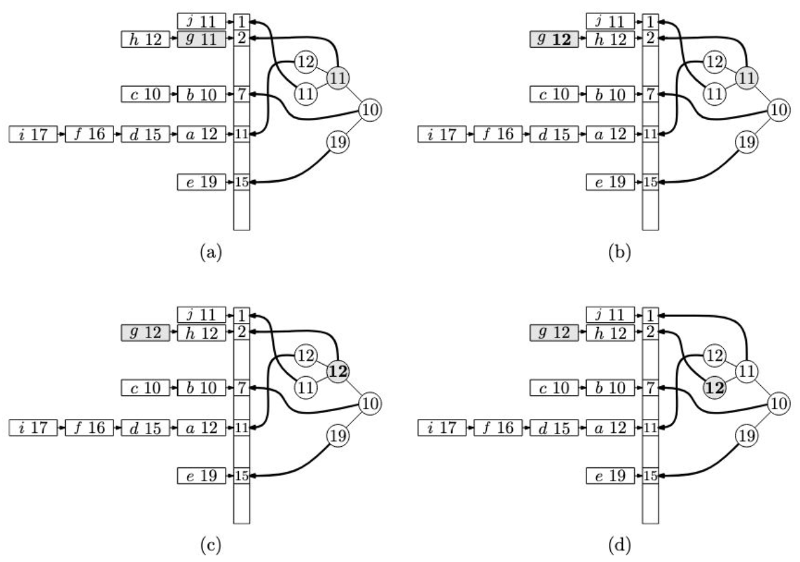

**Setup**

- Each rounded cost/size value has its own LRU queue. The **head** of each queue has the smallest H in that queue.
- The heap stores **only the H of each queue’s head**. The root holds the global minimum (b, H = 10), so **L = 10**.

Hit on g (g has cost/size = 2 and H = 11, and it is the head of queue 2)

| Step | Action                                                       | Cost           |
| ---- | ------------------------------------------------------------ | -------------- |
| (a)  | Find g using the hash table                                  | O(1)           |
| (b)  | Set H(g) = L + cost/size = 10 + 2 = **12**, then move g to the **tail** of queue 2. The new head is h (H = 12). | O(1)           |
| (c)  | Queue 2’s head changed (11 → 12), so update its heap node    | —              |
| (d)  | Re-heapify: 12 swaps with its child 11 (j)                   | O(log #queues) |

**Memory is full -> find victim:**

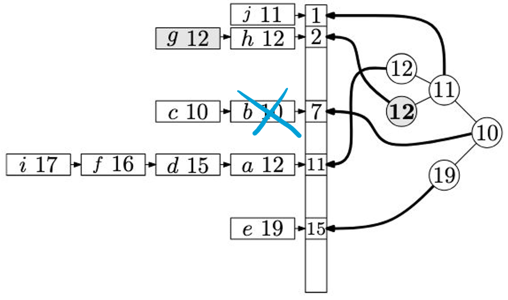

**Steps**

1. **Heap root:** points to the queue whose head has the smallest H.
2. **Evict that queue’s head**, which is the victim, and remove it from the hash table.
3. Fix the heap:
   - If the queue still has items, the next item becomes the new head, so update its heap node (only if its H differs).
   - If the queue is now empty, delete its node from the heap.
4. **Update L:** L ← new minimum H, which is the heap root.
5. **Repeat** steps 1–4 until there is enough room for p. Key-value sizes vary, so one eviction may not be enough.
6. **Insert p:** append it to the **tail** of queue c, with H = L + c. If queue c doesn’t exist yet, create it and add a heap node.

#### Rounding

**Problem:** cost/size is a fraction, but CAMP needs an integer key and a way to group similar ratios into a few queues.

**Objective:** Assign key-value pairs with similar cost-to-size values to the same LRU queue AND values that have different orders of magnitude should remain distinct.

**Solution 1: Convert to an integer.** Divide cost/size by a lower bound on the smallest possible ratio (1 / max size), which means multiplying by the largest size seen so far. This keeps values below 1 from all rounding to 0.

**Solution 2: Round using the high-order bits.** Keep only the top p bits and zero out the rest. Similar values merge into one queue, while values of different orders of magnitude stay distinct.

**[Regular rounding v.s. CAMP's rounding]**

Preserve only the p most significant bits starting with b, the highest order bit that is not zero. If b is less than p then the value is not rounded.

e.g. p=4

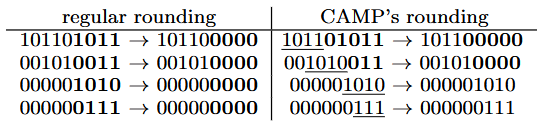

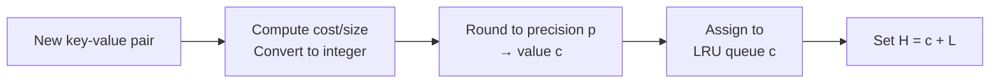

## Performance

**CAMP Precision v.s. number of LRU queues:**

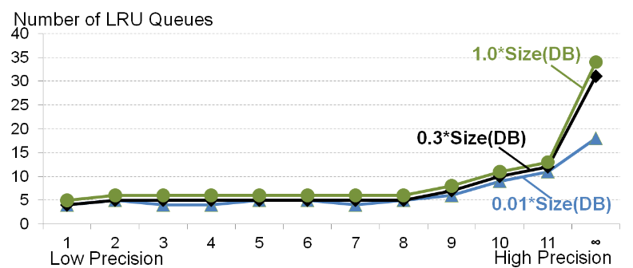

* A higher precision increases the number of LRU queues.
* With precision set to infinity, there are still LRU queues because of similarity in cost/size.

**Number of visited heap nodes -- CAMP v.s. GDS:**

> Cache Size Ratio = Size(Mem) / Size(DB)

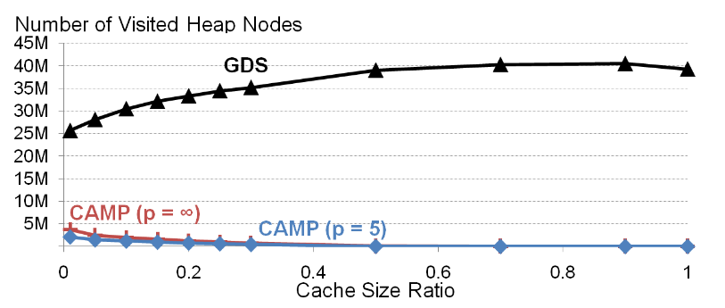

- **GDS:** rises with memory. Its heap holds every item, and it updates the heap on every priority change (**every hit**). More memory means more items and a bigger heap.
- **CAMP:** falls with memory, to nearly 0. Its heap holds only the queue heads (about 5 nodes) and is updated only when a **queue head** changes. More memory means fewer misses, so fewer updates.
- **p = 5 vs. p = ∞:** almost identical, so rounding adds no overhead problem.

**Cost-miss ratio v.s. precision:**

> Miss rate: Number of misses / total # of requests
>
> Cost-miss ratio: Sum the cost for each request that results in a **cache miss** / Sum of the costs for all the requests

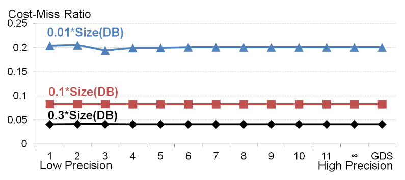

- **Precision has no effect:** every curve is flat, so low p performs as well as high p and as GDS.
- **Memory matters:** less memory gives a higher cost-miss ratio.

**CAMP v.s. LRU v.s. Pooled LRU:**

> **Pooled LRU**
>
> * Memory is **manually partitioned** into separate pools.
>
> - Key-value pairs are **grouped by cost** and each group is assigned to a pool (here, 3 pools: cost 1, 100, 10K).
> - Each pool runs **its own LRU**, so cheap and expensive items never compete.
> - Pool sizes are **fixed in advance**; most memory goes to the expensive pool.
> - **Drawbacks:** hard to configure, can’t adapt to changing workloads, and splitting resources hurts the miss rate.

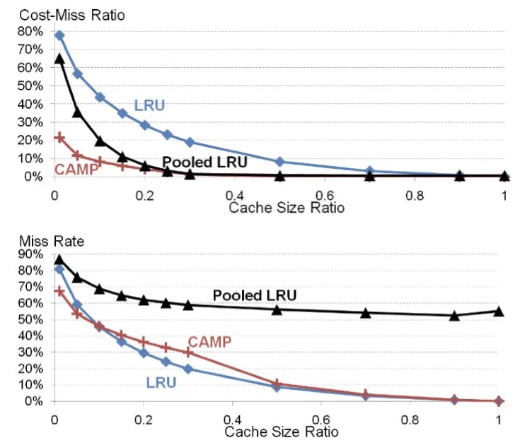

* LRU minimizes miss rate but not cost-miss ratio, because it only considers recency, while CAMP also considers **cost and size**.
* CAMP has the lowest **cost-miss ratio**, especially when **memory is small**. Its miss rate is close to LRU’s, slightly worse at some memory sizes because it favors expensive items.
* Pooled LRU improves on LRU’s cost-miss ratio and eventually matches CAMP’s. But it has by far the worst miss rate; **the cheap pools barely get any memory**.

**Context change:**

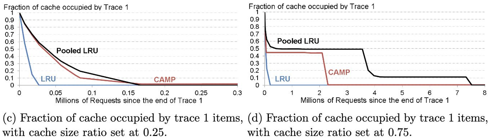

- **LRU adapts fastest** at any memory size, because it ignores cost.
- **CAMP adapts more slowly** and keeps expensive old items longer, but still faster than Pooled LRU.
- **More memory means slower adaptation** for CAMP and Pooled LRU, because L rises more slowly.

**Variable Size / Fixed Cost** (all key-value pairs have the same cost but different sizes)

- CAMP keeps **small** items in memory, which gives a lower miss rate than LRU.
- Pooled LRU has only 1 pool, so it is the same as LRU.

**Equi Size / Variable Cost** (all key-value pairs have the same size but different costs)

- Pooled LRU pools are hard to construct.
- CAMP still has the lowest cost-miss ratio; LRU’s miss rate is slightly better.
- Many distinct costs give thousands of queues at high p. A lower p cuts the queue count sharply with no real performance loss.