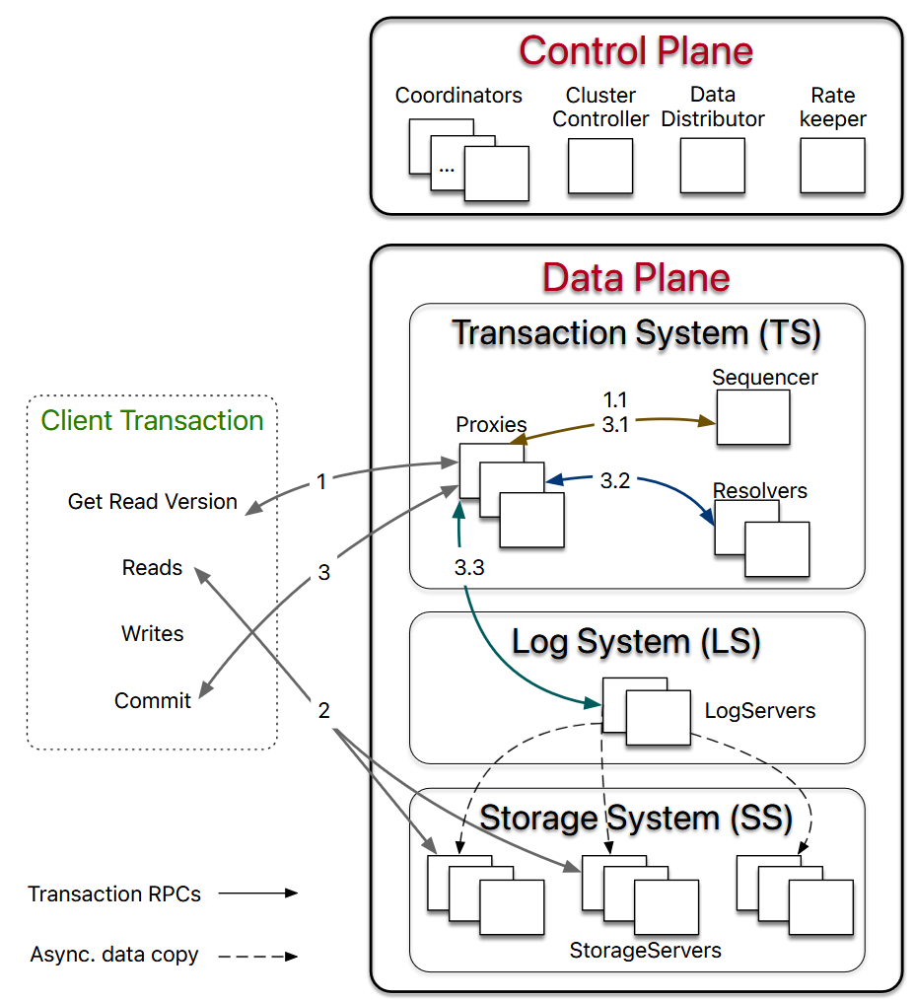
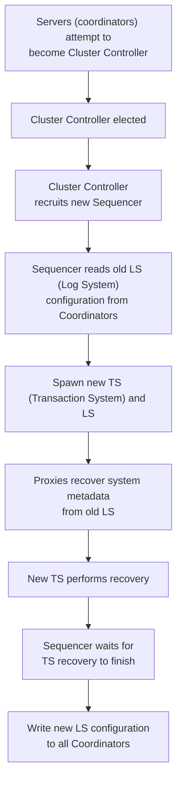
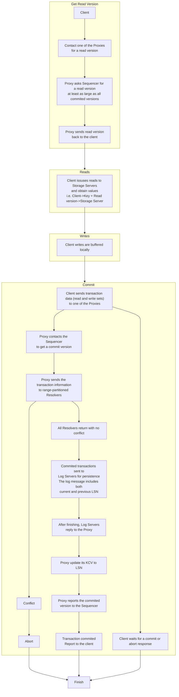
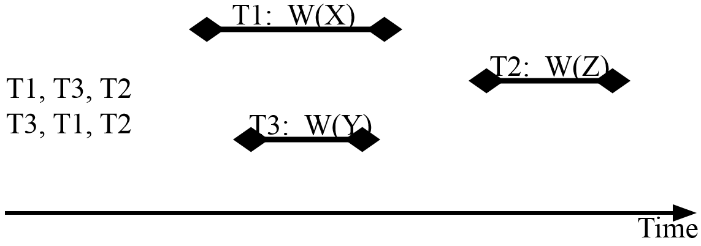
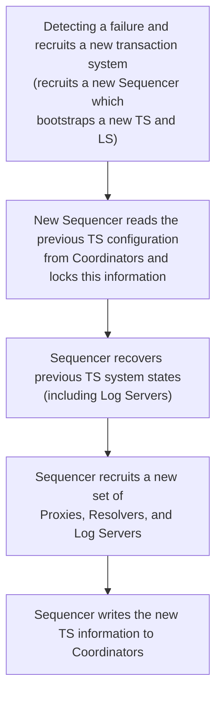
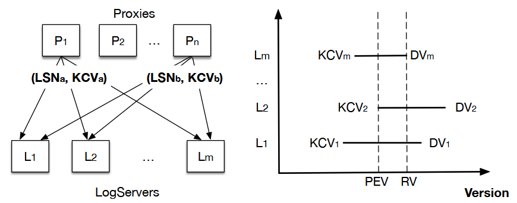
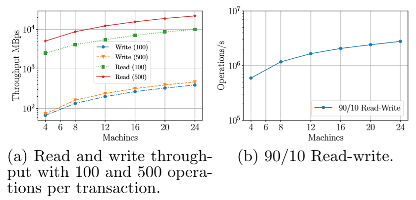
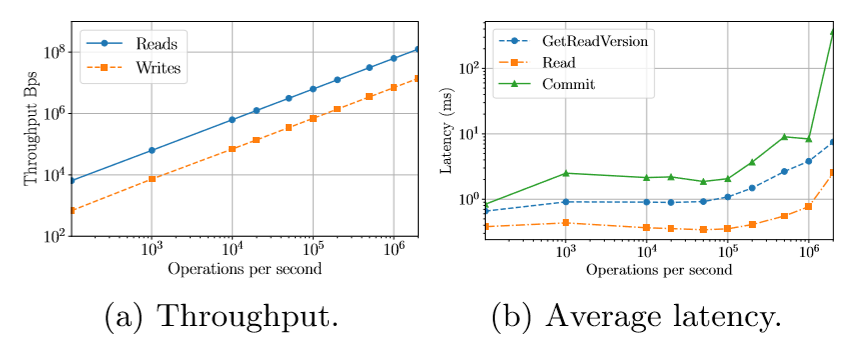
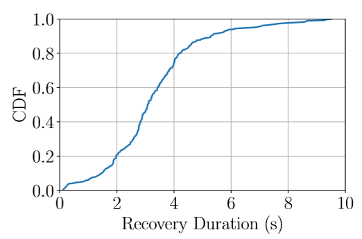

# Foundation DB

> week 4: [FoundationDB: A Distributed Key-Value Store](https://dl.acm.org/doi/epdf/10.1145/3592838)

## Architecture

An important thinking in the design of Foundation DB architecture is divide-and-conquer. FDB decouples the **transaction management system** (write path) from the **distributed storage** (read path) and scales them independently.

### Control Plane

**Load balancing, failure handling. System metadata and cluster-wide orchestration.**

Stateless (i.e. no persistence, don't need to remember the state and recover from it when failure appears).

* **Coordinators**
  * Persist critical system metadata (i.e. the configuration of transaction systems)
  * Elect a **Cluster Controller**
* **Cluster Controller** (singleton)
  * Monitor all servers in the cluster
  * Recruit three processes, **Sequencer, Data Distributor and Rate Keeper**
* **Data Distributor** (singleton)
  * Monitor failures
  * Balance data among **Storage Servers**
* **Rate Keeper** (singleton)
  * Provide overload protection for the cluster

### Data Plane

**Transactions with ACID semantics and data storage.**

Targets: OLTP (on-line transaction processing) workload, i.e. read-mostly, read and write a small set of keys per transaction, have low contention (conflict), and require scalability.

An **unbundled** architecture.

#### Transaction System (TS)

Stateless.

* **Sequencer** (singleton)
  * Assign a **read and commit version** to each transaction
  * Recruit **Proxies, Resolvers, and Log Servers**
* **Proxies**
  * Offer MVCC read versions to clients
* **Resolvers**
  * Check for conflicts among transactions
  * Range-based: A transaction may involve several ranges of key-value pairs. These ranges will be partitioned across several resolvers. These resolvers will work together to check the conflicts.

#### Log System (LS)

Stateful (store the log records of the transaction. In the recovery protocol, the state has to be restored).

* **Log Servers**
  * Act as replicated (one log have several copies), sharded (one log doesn't appear on all log servers), distributed persistent queues, each queue storing WAL (write-ahead-log) data for a **Storage Server**

#### Storage System (SS)

Stateful (store the persistent state of key-value pairs).

* **Storage Servers**
  * Each store a set of data shards (i.e. continuous key ranges) and serve client reads

### Scaling

* read -> add Storage Servers
* write -> add Proxies, Resolvers, and Log Servers

### Bootstrapping

> Metadata of Storage Servers -> Log Servers
>
> Log Servers configuration data -> all Coordinators

## Transaction Management

> The mapping between key ranges and storage servers are cached.
>
> Later on, Storage Servers continuously pull mutation logs from Log-Servers and apply committed updates to disks.
>
> Conflict checking: Rr (range of read) of one transaction overlaps with the Rw (range of write) of another.
>
> **LSN (Log Sequence Number)**: The last committed version number given by the Sequencer
>
> **KCV (the largest known committed version)** : KCV is the highest LSN that a Proxy knows has successfully committed

## Concurrency Control

### Strict Serializability

**Strict Serializable schedule**: An execution of concurrent transactions such that the outcome (resulting database state) is equal to the outcome of transactions executing serially AND **a transaction Tj that starts after the commit point of Ti is not re-ordered prior to it**.

> The time ranges of T1 and T3 overlaps, so their sequence can be re-ordered.

What does FDB guarantee:

* The read version is guaranteed to be no less than any committed version when Tx starts
* The commit version is larger than any existing read or commit versions

**The transaction system combines OCC and MVCC to ensure strict serializability.** 

### MVCC: Multi-Version Concurrency Control

Storage Servers maintain **multiple versions** of data, allowing read operations to access a consistent snapshot of the data at a specific "read version" without blocking writes. When a client reads a key, it specifies the read version it received from the Sequencer, and the Storage Server returns the value of the key at **the largest version less than or equal to the requested read version**.

* **Why MVCC?**

To ensure that one transaction can read from **a consistent snapshot** without blocking other transactions from continuing to write.

> For example, Ti reads two values, x and y, while Tj writes these two values at the same time.
>
> Ti reads x before its value is changed. Tj then changes these two values. And Ti then reads the value of y.
>
> If a history version (before Tj writes) is not saved, the x and y that Ti reads will not be consistent.
>
> But MVCC keeps several history versions, so Ti can get one consistent snapshot of both values.

* **MVCC window**: 

  The **limited time period** during which the database keeps multiple historical versions of data so transactions can read from a consistent snapshot.

  5 seconds in FDB (avoid taking too much memory).

  Recent changes are kept as multi-versioned data in the StorageServer's memory. Only after they leave the 5-second MVCC window are they written to the on-disk storage engine, which stores a single version per key.

### OCC: Optimistic Concurrency Control

FDB uses an optimistic approach where transactions do not take locks. Instead, conflicts are checked at commit time. This is the primary role of the **Resolver**.

Each transaction Ti has three phases:

* Read phase: reads the value of data items and copies its contents to variables local to Ti. All writes are performed on the temporary local variables.
* Validation phase: Ti determines whether the local variables whose values have been overwritten can be copied to the database. If not then abort. Otherwise, proceed to Write phase.
* Write phase: The values stored in local variables overwrite the value of the data items in the database.

The **Resolver** is the component that implements OCC. When a transaction is ready to commit, the Proxy sends its read and write key ranges to the Resolver(s). Each Resolver maintains a history of recently committed key ranges and their commit versions. It checks if the transaction's read set **conflicts with any writes** from other transactions that have committed since the current transaction's read version was issued. If any Resolver finds a conflict, the transaction is aborted; only if all Resolvers admit it can the transaction proceed to commit.

## Fault Tolerance & Recovery

**[Key concepts]**

* **LSN** (Log Sequence Number): The last committed version number given by the Sequencer to the Proxy. A Proxy sends **both LSN and the previous LSN** to **Resolvers** and **Log Servers** so that they can serially process transactions in the order of LSNs. Similarly, Storage Servers pull log data from Log Servers in increasing LSN order.

* **KCV** (Known-committed version): The **maximum LSN** that this Proxy has committed. **Log Servers** reply to the Proxy once the log data is made durable, and the Proxy updates its KCV to the LSN if all replica Log Servers have replied and this LSN is larger than the current KCV. Each **Log Server** also keeps **the maximum KCV received and a DV**.
* **DV** (Durable version): The maximum LSN persisted by the **Log Server**. DV is decided by each Log Server, and it's **ahead of KCV** (in flight). KCV is updated only when **all copies** of a record has been received by the Log Servers.
* **PEV** (Epoch's end version): maximum of all KCV received by the Sequencer.
* **RV** (Recovery's version): Minimum of all DV. **Logs** in the range of **[𝑃𝐸𝑉 +1,𝑅𝑉]** are copies from previous epoch’s Log Servers to the current ones, for healing the replication degree in case of Log Server failures.

Redo log processing is the same as normal log forward path in FDB. The new TS only needs to find out the end of the redo log, so it can accept transactions before all the old data in old Log Servers is processed.

> Replication degree = k
>
> Number of Log Servers = m

During the recovery of Log Servers (determine the end of redo log), the **Sequencer** asks for the **DV and KCV** of each Log Server.

Once the Sequencer has received more than **m - k** replies (no data has been completely lost, with no copy remained), **the maximum of all KCVs becomes PEV**. All data before PEV has been fully replicated.

The Sequencer chooses **the minimum of all DVs to be the RV** (for data before RV, as least one copy exists).

Logs in the range of **[PEV + 1, RV]** are copied from previous epoch’s Log Servers to the current ones, for healing the **replication degree** in case of Log Server failures.

Storage Servers will roll back any data larger than RV.

**[Replications]**

* **Metadata replication**: System metadata of the control plane is stored on Coordinators. As long as a quorum (i.e. majority) of Coordinators are live, this metadata can be recovered.
* **Log replication**: Each shard of log record is synchronously replicated on k=f+1 Log Servers (f: FDB can tolerate f failures).
* **Storage replication**: Every shard is asynchronously replicated to k=f+1 Storage Servers, which is called a team. A failure of a Storage Server triggers **Data Distributor** to move data from teams containing the failed process to other healthy teams.

## Performance

### Scalability

* Raw write throughput is three times higher, since each write is replicated three times to Log Servers and Storage Servers.
* Write operation's scalability is closer to linear.
* Higher operations result in higher throughput. But increasing operations further (e.g. 1000) doesn't bring significant changes.
* Write -> Log servers are CPU saturated; Read -> Storage Servers are saturated; 90/10 read-write -> Resolvers and Proxies are CPU saturated

### Throughput and average latency for different operation rate

* The throughput scales linearly with more operations per second (Ops) for both reads and writes.
* Read - single hop operation (client -> Storage Server), GRV - two hop (client -> Proxy -> Sequencer). So GRV has higher latencyj than read.
* When Ops is below 100k, the mean latencies remain stable. When Ops exceeds 100k, latencies increase because of more queuing time. At 2m Ops, Resolvers and Proxies are saturated.

### Reconfiguration Duration

* Recovery are not bounded by the data or transaction log size, and are only related to the system metadata sizes -> fast recovery. The new Transaction System can begin accepting new transactions even before all data from the old Log Servers has been replayed by the Storage Servers.
* Do not need to undo log processing. Only need to determine the end of the redo log from the old epoch (which is RV). Any data after that version is simply discarded by the Storage Servers.

