# The Gamma Database Machine Project

> Week 2: [ieee90.pdf](https://pages.cs.wisc.edu/~dewitt/includes/paralleldb/ieee90.pdf)

## Architecture

### Shared nothing architecture

**Node structure:**

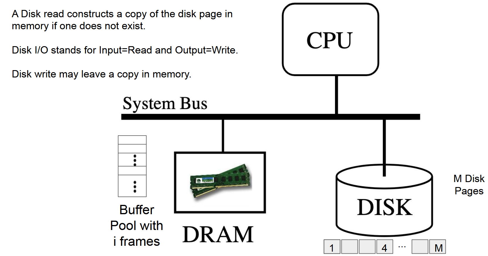

* **Each node** has its own network interface (NIC, Network Interface Card), DRAM (Dynamic Random Access Memory), mass storage device (disk),  and processor (CPU).
* When you format a disk to be a certain block size, a certain piece of the memory inside DRAM is also formatted to contain frames of that block size. (size of the frame in buffer pool = block size in disk)
* When you need page 1, a copy of this page will be written into a memory buffer (in DRAM)
* How to find that page in memory? -- By the hash table. The hash table is in key-value format, key: disk page number, value: its address in memory
* When looking for a page -> Can be found in hash table? -> Yes, get the location. -> No, get from disk and put to the main memory.
* When something gets changed in the memory, it is marked as dirty. After flushing it back, it get clean. (No need to flush every time something has changed)
* **DRAM** - quick access (nanoseconds), volatile (power-off, then nothing is remained); **Disk** - slow access (milliseconds), non-volatile

**Shared-nothing architecture:**

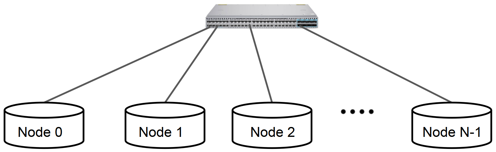

* Since each node has their own CPU, NIC, disk, and DRAM, the need for cooperation is reduced -> Don't need to waste time on network switch

**Gamma process architecture:**

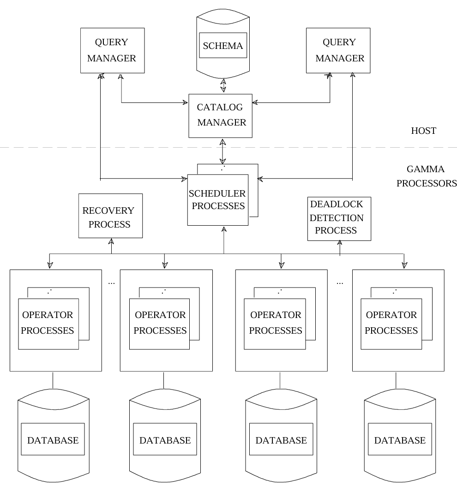

* **Catalog Manager**: A central repository of all conceptual and internal schema information for each database. The query manager utilizes the catalog manager to make sure that the syntax of the query is correct.

* **Query Manager**: One query manager process is associated with each active Gamma **user**. Responsible for query parsing (create query trees), optimization, compilation, etc.

  * Single-site query (e.g. select employees with salary=60k) : the QM identifies the appropriate fragment and issue that query to the appropriate process here. (Single-site query will bypass the scheduler process)
  * Multi-site query: The **scheduler** becomes involved. QM sends the query to the scheduler. The scheduler process activates  **operator processes** at each query processor selected to execute the operator, gather the results, and returns it to QM to display for the user.

* **Scheduler Processes**: Each multisite query is controlled by a scheduler process.  Scheduler processes can be run on any processor. **A centralized dispatching process** is used to assign scheduler processes to multi-site queries.

* **Operator Process**:  At least one Operator Process is employed **at each processor** participating in the execution of the operator. These processes are started in advance (not when doing queries).

  A message is sent from the scheduler to each thread, telling it to become a select, a project, hash-join build, has-join probe, etc. The message specifies the role of the thread.

## Key techniques

### Data declustering

* Partitioning attribute

**Strategy**:

* No partitioning attribute: random, round-robin
* Single attribute: hash (e.g. mod), range
  * When selection is done on the partitioning attribute: selection only needs to be done on a single node
  * When selection is done on the non-partitioning attribute: all nodes need to do the query
* What we get from partitioning -- a fragment/shard

### Query processing algorithm

Example: $TMP2 \leftarrow \sigma_{dname=Toy}(Emp\bowtie Dept)$

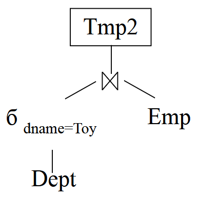

1. Initiate 3 processes: one for **storage** into TMP2, one for the **select** operator, one for the **join** operator

2. Read the Dept table and produces all the records with dname = Toy, forwarding them to the **Join operator** of Step 2

   > The select operator reads the records of a **fragment** and produce those satisfying a selection predicate as its output **stream**

3. The **Join Build operator** *builds* a hash table on dname of its received records

4. Read the Emp record and forward to the **Join operator**. This operator *probes* the hash table for the qualifying record, forwarding them to the **Store operator** of Step 1

**[The join operator: 2 steps --> step 3 (build) + step 4 (probe)]**

* **Build**: Constructs a hash table on the inner relation, using the join attribute

  - Usually use the **smaller** relation as the inner relation, so that its hash table fits in memory
  - Each tuple is hashed on the join attribute, and the hash value is used as an index into the split table to obtain the address of the destination joining process (processor + port)
    - Data is sent directly from one operator to another; it does not flow through the scheduler
  - Arriving tuples are inserted into a memory-resident hash table by hashing on the join attribute value (at each joining processor)
  - Since the outer relation is routed with the same hash function and split table in the probe phase, all tuples with the same join attribute value end up at the same joining processor

  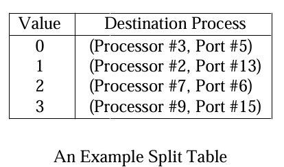

* **Probe**: Look up the hash table for a joining record

  * Tuples from the outer relation are used to probe the hash table for matching tuples. Every time it finds a match, it produces an output.
  * Probe begins after Build completes (no overlap)

**Scheduler: controls and coordinates where to send its stream of records**

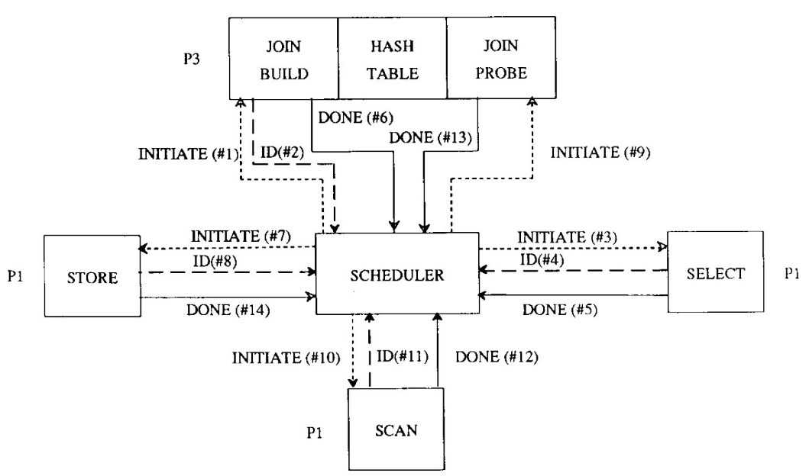

* After a process is initiated, this process gives its socket address back to the scheduler.
* When initiating the SELECT process (#3), the scheduler tells the processor that it should send the data to the port number that JOIN BUILD process just gave back to it (#2).
* When SELECT is done, it directly sends all its data to the JOIN BUILD process, and tells the scheduler it gets done. Then the JOIN BUILD process starts to build hash table.
* When hash table has been built, the scheduler initiates the STORE process and the JOIN PROBE process. Then initiates the SCAN process to read Emp tuples, and send these data to the port number of JOIN PROBE.
* After the JOIN process, the result heads to the temporary table. The scheduler has given it the port number of the STORE process when initiating.

**How to do when there's not enough memory? -> Hybrid hash-join**

1. Make sure the inner (build) table is the smaller of the two tables, say Dept.

2. **Break the inner table into M buckets** using a hash function. The ideal function ensures each bucket is small enough to fit in memory. **Write these buckets to disk**.

3. Break the outer table (Emp) into M buckets using the same hash function used in Step 2. Write these buckets to disk.

4. For i = 1 to M:
  a. Stage Bucket i of Dept in an in-memory hash table
  b. Read Bucket i of Emp and probe the hash table for joining records

  > Records in bucket i of the inner table (Dept) may join with the records in bucket i of the outer table (Emp) only.
  >
  > **Hybrid Hash-Join (optimization): The first bucket of the inner table (Dept) does not have to be written to disk**, it can be staged in memory. Similarly, the first bucket of the outer table (Emp) is not required to be written to disk. It may probe the hash table of the inner table (Dept) for joining records.

**Parallel version of the hybrid hash-join: two kinds of split tables, faster I/O for each fragment** 

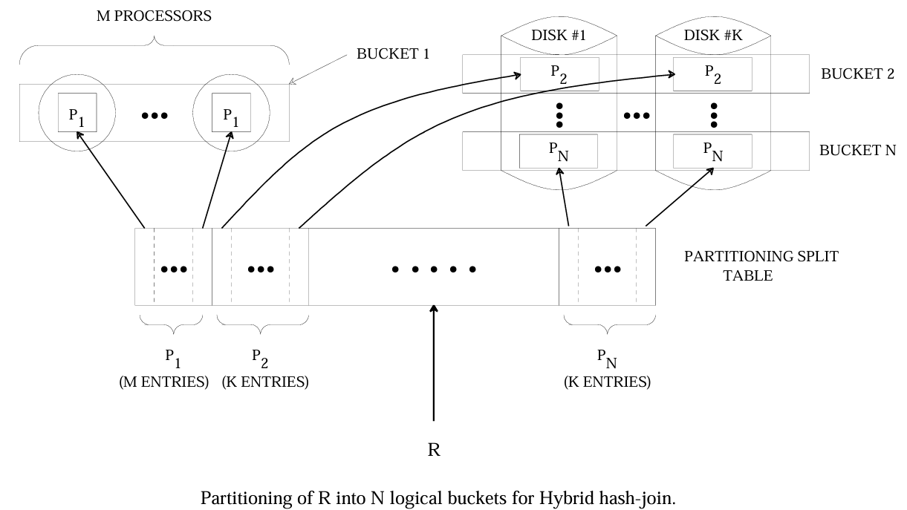

* **Partitioning split table**: Separates both R and S into **N logical buckets**, and declusters buckets 2 to N (the ones that must be stored temporarily) across the **K disk sites** (each of these buckets has K entries in the table).
* **Joining split table**: During the **joining phase**, routes the tuples of a bucket by hashing **to the M joining processors**, with each processor handling one portion of that bucket. These processors do not necessarily have disks attached, and M may be less than, equal to, or greater than K.

### Failure management - chained declustering

**Interleaved declustering**:

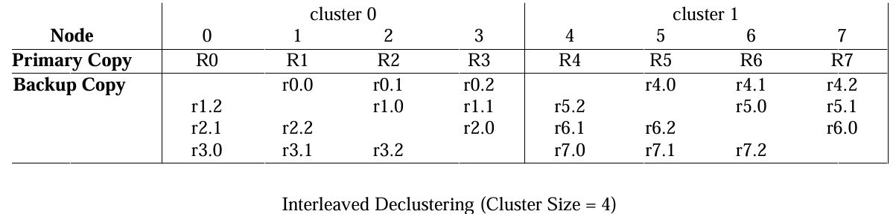

* The set of disks are divided into units of size N called **clusters**
* Each backup fragment is subdivided into N−1 subfragments, and each subfragment is placed on a different disk within the same cluster
* Failure of Node 1 distributes its load on Nodes 0, 2 and 3 --> when a node fails, the load can be distributed evenly across the other 3 nodes
* This kind of system can only tolerate one failure in one cluster

**Chained declustering**:

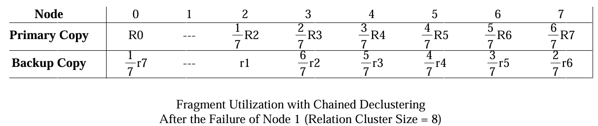

* The backup copy is stored on the adjacent node (only on one node)
* With the failure of node 1, primary fragment R1 can no longer be accessed and thus its backup fragment r1 on node 2 must be used for processing queries that would normally have been directed to R1. However, instead of requiring node 2 to process all accesses to both R2 and r1, chained declustering offloads **6/7-ths of the accesses to R2 by redirecting them to r2 at node 3**. In turn, 5/7 ths of access to R3 at node 3 are sent to R4 instead.
* This dynamic reassignment of the workload results in **an increase of 1/7-th** in the workload of each remaining node in the cluster
* Every time two adjacent nodes fail, data will be lost

## Other techniques

### Concurrency control

Each site in Gamma has its own **local lock manager** and **deadlock detector**. The lock manager maintains a lock table and a transaction wait-for-graph.

In order to detect multisite deadlocks, Gamma uses **a centralized deadlock detection algorithm**.

* The **centralized deadlock detector** sends a message to each node periodically, requesting the **local transaction wait-for-graph** of that node.
* The centralized deadlock detector creates a **global** transaction wait-for-graph.
* When a cycle is detected in the graph, the centralized deadlock manager chooses to abort the transaction holding the fewest number of locks.

### Recovery

- LSN = node number + local sequence number.
- Each query processor i sends its log records to log manager (i mod M); this static mapping makes recovery easy.
- Log manager tracks the flushed LSN of each node and returns it to the nodes.
- WAL: a dirty page can be written to disk only if page LSN ≤ flushed LSN; otherwise, flush the log first.
- Buffer manager keeps T clean pages; if below T, the local log manager asks for a log flush in advance.
- Commit: the scheduler sends commit records to the log managers (group commit).
- Abort: each node fetches its log records and undoes them in reverse order (ARIES).

## Performance

* **Speedup**: Keep the problem size fixed and add more nodes. Ideally, speedup is linear: with N times as many nodes, a query runs N times faster.
* **Scaleup**: Grow the problem size and the number of nodes proportionally. Ideally, the response time stays constant.

### Select speedup

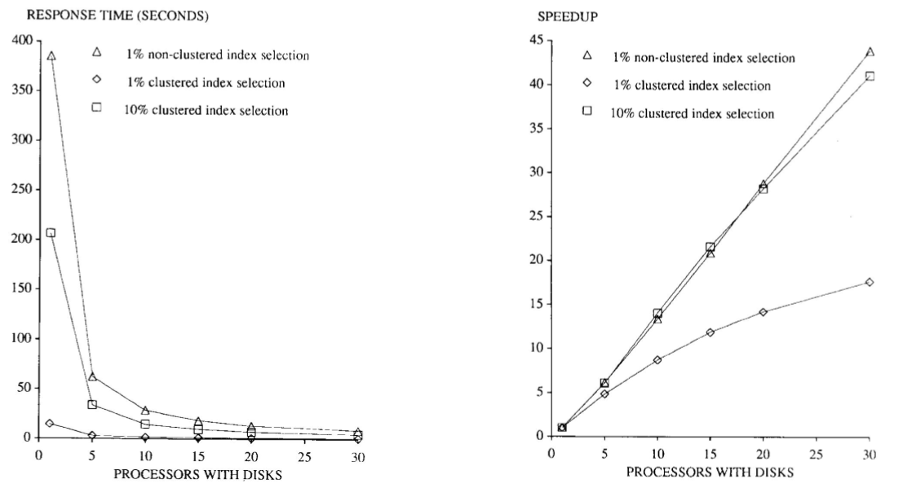

* speedup (N) = response time for 1 processor / response time for N processors
* Response time for 10% is higher: the cost of declustering and storing the result increases
* Why the speedup of 10% clustered index selection is super-linear: When the increase of processors, a relation occupies relatively smaller percent of the whole disk (With one processor, 1 million tuple relation occupies about 66% of the disk; But with 30 disk drives, this is only 2%). Since the seek time is proportional to the square root of the distance traveled by the disk head, reducing the size the relation fragment on each disk significantly reduces the amount of time that query spends seeking.
* Why 1% clustered is sub-linear: The cost of initiating a select and store operator on each processor is high. For clustered index, the original process time is short, so the cost is more apparent.

### Select scaleup

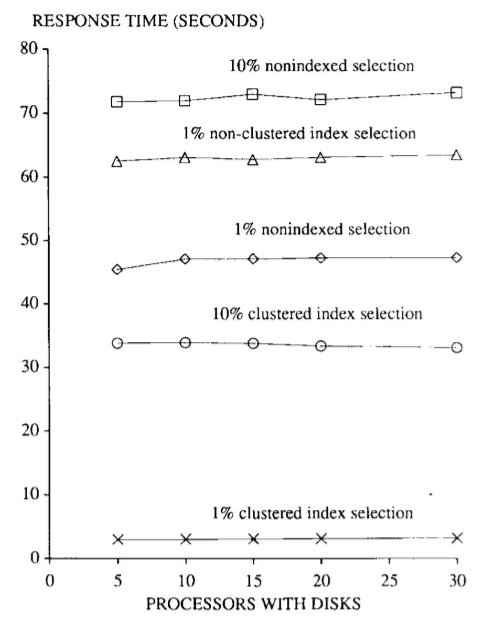

* Almost constant.
* Slight increase -> due to the overhead of initiating a selection and store operator at each site.

### Join speedup

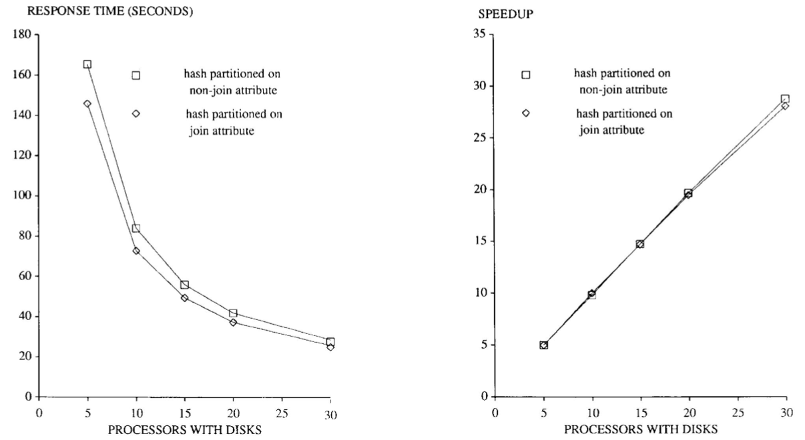

* If the relation is hash partitioned on non-join attribute, the two input relations must be redistributed by hashing on the join attribute value of each tuple.
* Speedup - slightly sublinear -> 1. The cost of starting four operator tasks on each processor increases; 2. The effect of short-circuiting local messages diminishes as the number of processors is increased (when n=5, 1/5 of the tuples are destined for itself and don't need to go through network; while when n=30, the percentage is only 1/30).