# Grasper: A High Performance Distributed System for OLAP on Property Graphs
> Week 7: [Grasper: A High Performance Distributed System for OLAP on Property Graphs](https://www.cse.cuhk.edu.hk/~jcheng/papers/grasper_socc19.pdf)


## Background

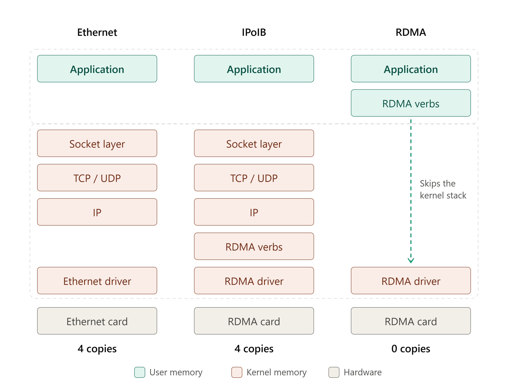

**Ethernet: Copies data 4×, 2× at receiver, 2× at sender**

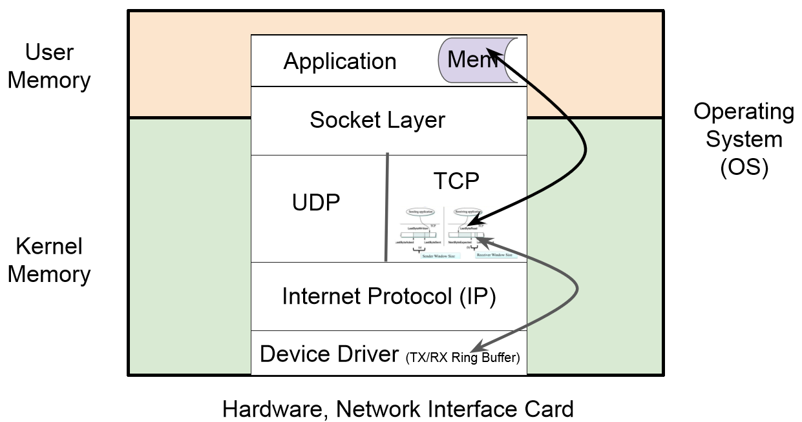

**Sender (2 copies)**

```
Application memory ──Copy 1──▶ Kernel TCP buffer ──Copy 2──▶ NIC ring buffer ──▶ wire
                  (via Socket)(TCP/IP add headers)(via Ethernet driver)
```

**Receiver (2 copies)**

```
wire ──▶ NIC ring buffer ──Copy 3──▶ Kernel TCP buffer ──Copy 4──▶ Application memory
                 (via Ethernet driver)(TCP/IP remove headers)(via Socket)
```

>**Socket:** The interface a program uses to hand data to the OS, like `send()` and `recv()`. The first copy happens here.
>
>**TCP:** Provides reliable delivery by splitting data into packets, numbering them, acknowledging receipt, and retransmitting lost packets. **UDP** is a faster alternative with no such guarantees.
>
>**IP:** Adds source and destination addresses so routers can deliver each packet to the right machine.
>
>**NIC (Network Interface Card) ring buffer:** A fixed-size circular buffer in kernel memory, managed by the driver, used to hand data between the OS and the network card. The TX ring holds outgoing data and the RX ring holds incoming data. Producer and consumer pointers advance around the ring and wrap back to the start. The NIC accesses it via DMA (Direct Memory Access), so ring buffer ↔ wire is not a copy.

CPU needs to get involved in this process.


**RDMA (Remote Direct Memory Access): Zero copy**

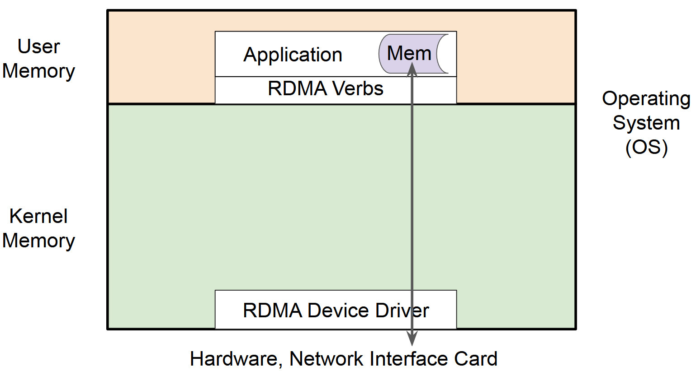

Avoid the overhead of CPU getting involved in the message writing -> Minimize latency and maximize throughput. Insensitive to the increase in the size of the payload.


**IPoIB (IP over Infiniband): 4× copies**

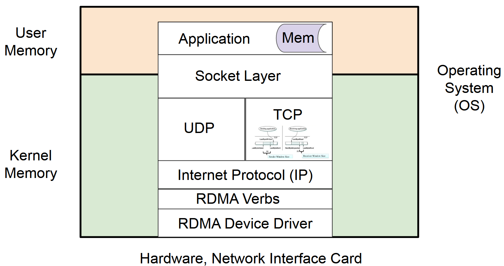

The same TCP/IP software (as Ethernet) stack runs on RDMA hardware. Applications need no changes and gain bandwidth, but there are still 4 copies.


## System Architecture

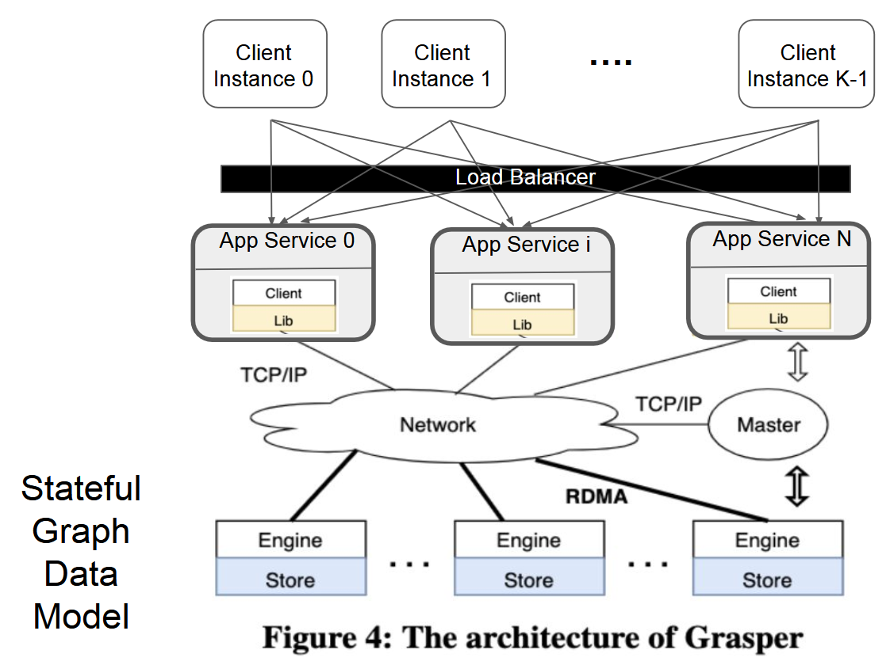

* Client
  * Connect to query servers through **TCP/IP network**
  * Submit query strings and receive query results
* Query server
  * Connected by **RDMA network**
  * Receive and process multiple queries concurrently with a pool of worker threads
  * **Data store** (partitioned Property Map data) + query engine -> **Stateful Processing**
  * Stateful: query engine is bound with data storage; everything is in main memory (different from JanusGraph)
* Master
  * Monitor the progress of query execution on each query engine
  * Coordinate the assignment of incoming queries from clients to servers based on the current load of each engine

**[Network Architecture]**

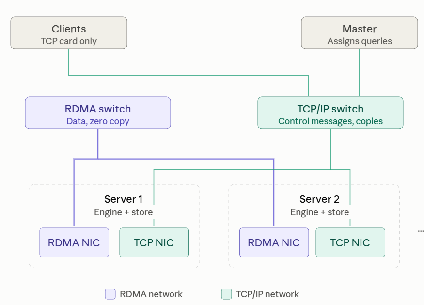

* Clients: TCP card; Server: TCP NIC + RDMA NIC
* Servers use RDMA to exchange graph data during query processing -> no overhead of data copy, do not involve CPU
* TCP is used in the transfer of control message & reply message


## Data Store

### Property Graph (PG) Data Model

Vertices V -> entities; Edges E -> the relationship between two entities

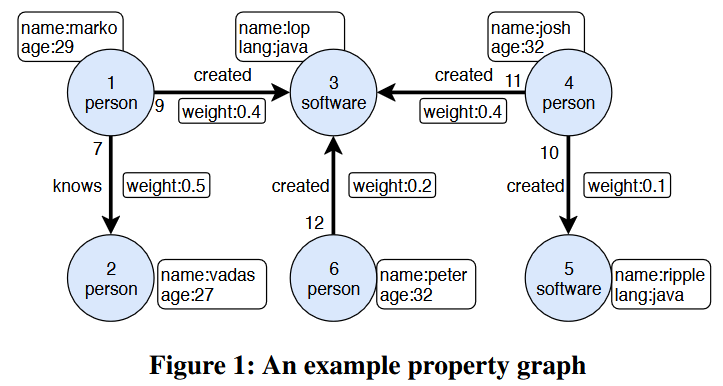

### Query Language: Gremlin

Who does Marko know?

```groovy
g.V().has('name', 'marko').out('knows').valueMap()
```

Who knows Marko?

```groovy
g.V().has('name', 'marko').in('knows').valueMap()
```

Who has created a Java Program?

```groovy
g.V().has('lang', 'java').in('created').valueMap().dedup() // deduplication
```

Top person who created most software?

```groovy
g.V().order().by( __.outE().hasLabel('created').count(), desc) .valueMap()
```


**Five general steps in Gremlin:**

| Category       | Input → Output             | What it does                                                 | Example steps                                                | Example (Modern Graph)                               |
| -------------- | -------------------------- | ------------------------------------------------------------ | ------------------------------------------------------------ | ---------------------------------------------------- |
| **Map**        | 1 → 1                      | Transforms each input into exactly one output                | `values()`, `properties()`, `id()`, `label()`, `count()`, `project()`, `match()` | `g.V(1).values('name')` → `marko`                    |
| **flatMap**    | 1 → 0 or many              | Expands each input into zero or more outputs (graph traversal) | `out()`, `in()`, `both()`, `outE()`, `inE()`, `bothE()`, `unfold()` | `g.V(1).out()` → `vadas`, `lop`, `josh`              |
| **Filter**     | 1 → 0 or 1 (unchanged)     | Keeps or discards each input without modifying it            | `has()`, `hasLabel()`, `is()`, `or()`                        | `g.V().has('name','marko')` → `v[1]`                 |
| **sideEffect** | 1 → 1 (unchanged)          | Passes data through while recording something for later use  | `store()`, `aggregate()`                                     | `g.V(1).out().aggregate('x')` → saves results in `x` |
| **Branch**     | 1 → several sub-traversals | Sends data into multiple sub-traversals and combines the results | `local()`, `choose()`, `coalesce()`, `union()`               | `g.V(1).union(out('knows'), out('created'))`         |


#### Gremlin v.s. SQL

* Gremlin is a procedural/traversal query language ('how' and 'what'). SQL is a declarative/non-procedural query language ('what' only) -> Gremlin users must **specify a chain of steps** that describes a path through the Graph DB
* Gremlin is streaming. SQL is set oriented.
* Gremlin processes vertices and edges with properties. SQL processes tables with column headings.


### Physical Design of Data

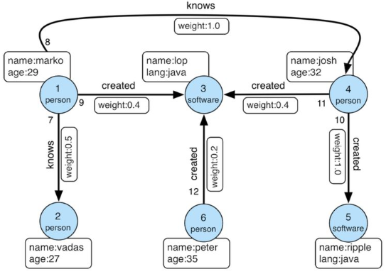

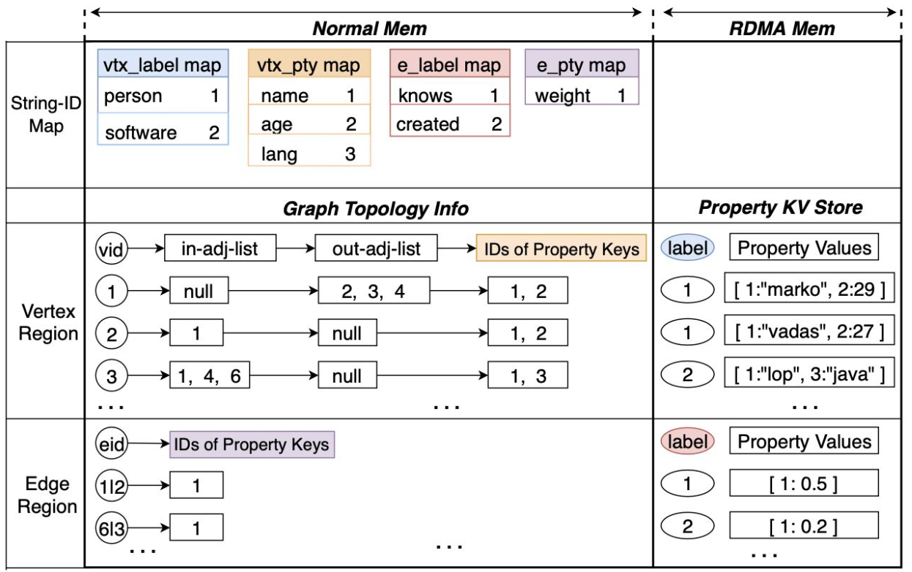

> For vid=1:
>
> * in-adj-list=null -- no incoming edge
> * out-adj-list=2,3,4 -- outgoing edges link to node 2, 3, 4
> * IDs of Property Keys=1,2 -- has property *name* and *age*
> * Property KV Store -- label=1 -- this node is a person
> * Property KV Store -- Property Values -- name="marko", age=29

* **Normal Memory:** store those graph data that are accessed locally during query execution, i.e., **graph topology** and **intermediate results** generated by queries
  * Maps all strings in the labels and property keys into unique IDs after data loading, in order to save network bandwidth and memory consumption (**String-ID Map**)
* **RDMA Memory**: store the data that could be **remotely accessed** by other query engine; distributed RDMA-enabled key-value store (**KVS**) for storing **vertex/edge labels and property values**
* Partition vertices/edges (Main Memory) and the properties (RDMA Memory) separately -> avoid uneven storage


## RDMA Communication

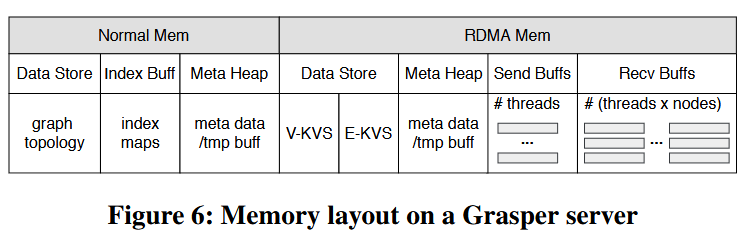

**One-side RDMA**: The memory address in a remote machine where a message is to be sent is set by the **sender side,** and the RDMA operations complete without any knowledge of the remote process -> higher bandwidth, lower latency

**SendBufs & RecvBufs:** In each query server, there are w SendBufs and a (w × n) 2D RecvBufs to form an RDMA Mailbox, **where w is the number of worker threads in a query server and n is the total number of query servers**.

* SendBufs[i]: The sending messages of a worker thread for RDMA communication
* RecvBufs\[i]\[j]: Keeps those messages that are received from query server j and to be consumed by worker thread i for efficient query processing without locking


### Message Dispatching

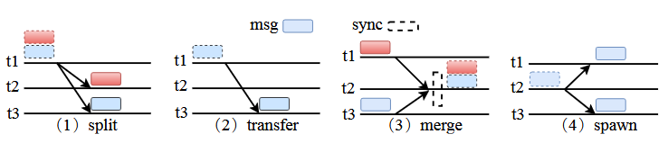

1. **Split:** A message that is too large is broken into multiple smaller messages and sent to different threads.
2. **Transfer:** A message is sent from one thread to another thread for the next step.
3. **Merge:** Messages from multiple threads are collected at one thread, which waits (sync) until all of them arrive before continuing.
4. **Spawn:** One message is duplicated and sent to multiple threads, so that sub-queries can run in parallel.


## Query Engine

### Query Plan Construction & Optimization

Flow types: the flow pattern of each query step according to its functionality

#### Three flow types

| Flow Type      | What it does                                                 | Parallelism                                               | Synchronization                                           | Message pattern | Example steps                                  |
| -------------- | ------------------------------------------------------------ | --------------------------------------------------------- | --------------------------------------------------------- | --------------- | ---------------------------------------------- |
| **Sequential** | Receives a message, processes it, and generates new message(s) for the next step | **Yes.** Messages are independent.                        | Not needed                                                | Transfer        | Traversal and filter steps: `in`, `out`, `has` |
| **Barrier**    | Collects **all** messages from the previous step and performs a **functional aggregation** before proceeding to the next step | **No.** Aggregation runs in one place (1 thread globally) | **Always required:** must wait for all messages to arrive | Merge           | `count`, `max`                                 |
| **Branch**     | Duplicates the received message as input to multiple **sub-query branches**, then merges their results back into one query step | **Yes.** Sub-queries run in parallel                      | Required at the merge point                               | Spawn + merge   | `and`, `or`, `union`                           |


#### Query Optimization

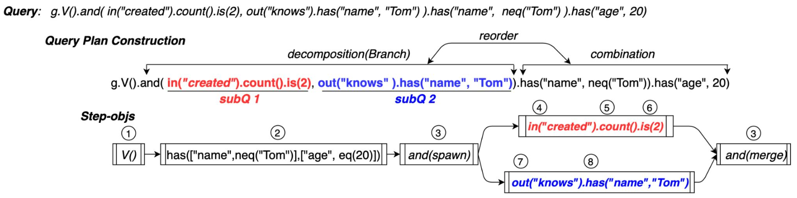

- **Reorder**: Move the filters `name ≠ Tom` and `age = 20` to the front to shrink intermediate results.
- **Combination**: Merge the two `has` steps into one step (②).
- **Decomposition**: Split `and` into subQ1 and subQ2. The `and(spawn)` step copies each vertex to both branches, which run concurrently, and `and(merge)` combines their results.

**DAG of the query:** Every query step belongs to only one **flow type**

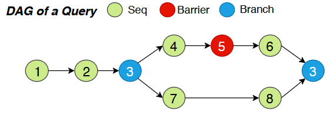


### Expert Model

An **expert** is a physical query operator that processes **one category of similar query steps**. For example, the Filter expert handles `has`, `hasKey`, and `hasValue`.

- Each server runs **one expert per category**. Together they form the **expert pool**.
- Each expert has its own **cache, index, `execute()` function, and routing rule**.
- All threads running the same expert **share its cache and index**.

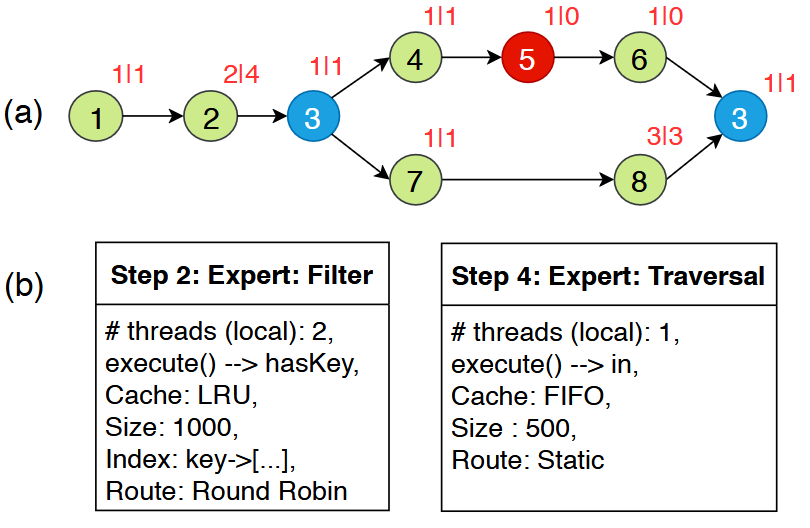

#### Three Features

* **Adaptive parallelism control.** Each step's workload is measured by the **number of messages** it receives on each engine. An expert can simply set the parallelism as the number of messages.

  * Barrier steps (e.g. `count`) use 1 thread globally because of tis aggregate function.
  * Both sequential and branch query steps have no limitation on parallelism.

* **Tailored optimizations for query steps.** Similar steps have similar data access patterns, so each expert is optimized for its own pattern.

  * e.g. specific caching strategy, cache size, message routing rules, etc.

* **Thread binding and load balancing.**

  > **NUMA node:** One CPU plus the memory attached to it. A CPU accesses its own local memory quickly and the other CPU's memory more slowly, which is what non-uniform memory access means.
  >
  > **CPU core:** An execution unit inside a CPU. In Grasper, each CPU has 8 cores.

  * Each **thread** is bound to one **CPU core** to avoid context switching.
  * Threads are divided into 6 **thread regions** by expert type. Each region sits within **one NUMA node**, so each expert accesses only local memory.
  * Each expert routes outgoing messages evenly across threads to prevent stragglers.


### Workflow

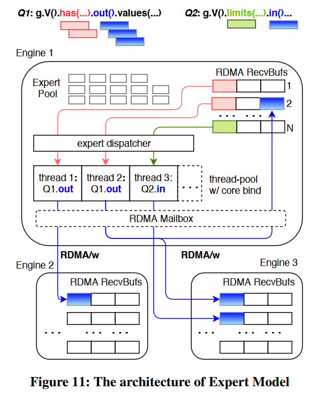

1. At startup, the engine creates all experts, which stay alive until shutdown.
2. Each thread has its own **RDMA RecvBufs**, which other engines write messages into.
3. An idle thread reads a message, and the **expert dispatcher** calls the matching expert's `execute()` based on the step type.
4. The expert processes the message and **routes the new messages** to the threads that run the next step.
5. One engine processes multiple queries at once. For example, threads 1–2 run Q1's `out` while thread 3 runs Q2's `in`, all sharing the Traversal expert's cache.


## Optimizations

**[Graph Partitioning]**

Topology (vertices and edges) goes into Normal Memory, and properties go into the **RDMA KVS**. The two are partitioned **separately** by ID using hash partitioning. Two reasons for doing like that:

* RDMA makes the network no longer the bottleneck.
* Co-locating topology with properties causes imbalance.


**[Index Construction]**

* Indexes let filter steps find matching vertices or edges (e.g. `has`, `hasLabel`, and `hasValue`) without scanning the whole graph.
* A special Index expert builds the index on every engine at the same time.
* The Index expert hands the index to the expert that uses it.


**[RDMA-Enabled KVS]**

**Structure:**

- **Header:** N buckets, each with multiple slots. Each slot stores a **pointer**, i.e. the offset and length of a value in the entry region. It works like a catalog.
- **Entry:** Stores the actual property values.


**[Work Stealing]**

- Because RDMA removes the network bottleneck, stragglers are mainly overloaded worker threads.
- An idle thread steals messages from the RecvBufs of busy threads, which improves CPU utilization and reduces latency.
- **Stealing order** (nearest first): same thread region → other regions in the same NUMA node → other NUMA nodes.


## Performance

### Ablation study

Remove each part to see the effect of each design decision

* w/o RDMA -> use IPoIB: Largest effect. Even the simplest query needs to frequently access the properties on remote servers through the network.
* w/o Q.Ops -> no query optimization: Does not help simple queries.
* w/o working stealing: Work stealing is effective because latency tests run one query at a time, leaving many threads idle.
* w/o APC (adaptive parallelism control) - process message with fixed parallelism of 1 in each server: APC achieves speed-ups in processing all queries, especially for the complex queries.


### Speedup

Add number of machines, but the data size is kept unchanged.

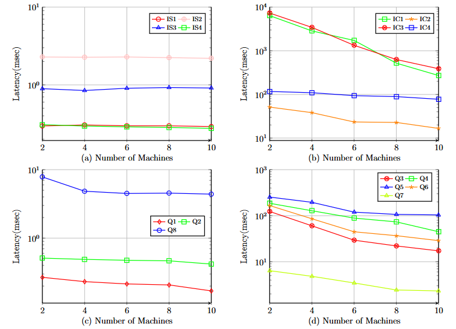

* Going from 1 to 10 machines makes queries faster, but less than 10x (sublinear).
* Some simple queries actually slow down, because network overhead outweighs the benefit of parallelism.
* Traversal-based and filter-based query steps (sequential steps) achieve more speedups.


