# Hybrid-Range Partitioning Skate y: A New Declustering Strategy for Multiprocessor Database Machines
> Week 5: [Hybrid-range partitioning strategy: a new declustering strategy for multiprocessor databases machines | Proceedings of the sixteenth international conference on Very large databases](https://dl.acm.org/doi/10.5555/94362.94517)

## Background Knowledge

### Physical Organization of Records in Blocks

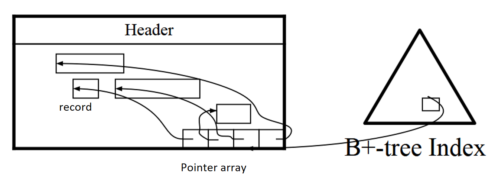

* **Pointer array**: Each page consists of an array of pointers, each pointer points to a record within the block.
* **Record Identifier (RID) / Tuple Identifier (TID)**: Block number + index in the pointer array. Used to locate a record. RID is used when someone outside the block (B+ index tree) wants to specify a record (the exact location is not known).
* How to **delete**? 
  * Follow the pointer in the pointer array to locate the record -> Free the space of that record -> Set the pointer of that record to be *null*.
  * RID of a record doesn't change.
  * When a record has just been deleted, the B+ tree remains unchanged -> When someone looks up this record -> Find the slot in the block -> Get *null* -> At that time, the B+ tree is healed (**lazy deletion**)
* How to **insert**?
  * Look up the header -> Find out how many records are within the block & how many slots are used -> Add a new slot -> Put the record in the free area -> Set the address of the pointer to that area (of the new record)

### Index Structures

#### Hash index

Suitable for processing **exact match predicates**. For **range predicates**, the partitioning attribute are directed to all node, which is not suitable for **selective** query (query that only processes a few records are better to be done with less nodes). But for **non-selective exact match** selection predicates, those referencing the partitioning attribute are better to be distributed to more nodes (increase parallelism), so hash index is also not suitable.

**[Non-clustered hash index]**

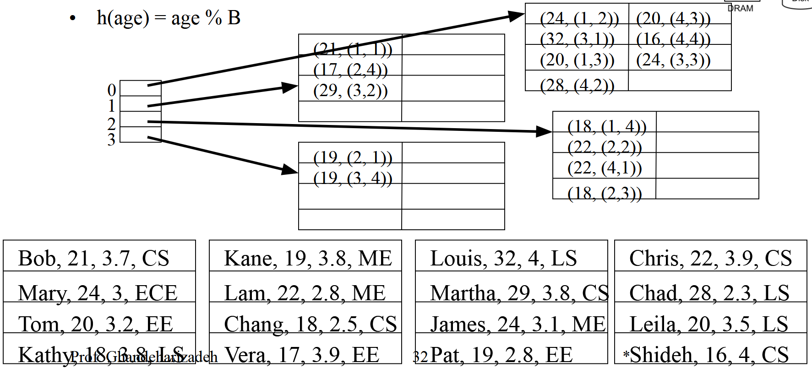

* When looking up for age=30, it only needs to read one bucket (one disk page I/O) before it finds that there's no qualifying records.
* Non-clustered: The sequence of index has nothing to do with the physical sequence of records in data file. After reading the index page, we must fetch each data page referenced by the RIDs (no data in leaf nodes of the index tree). In the worst case, a query can end up reading all data pages.

**[Clustered hash index]**

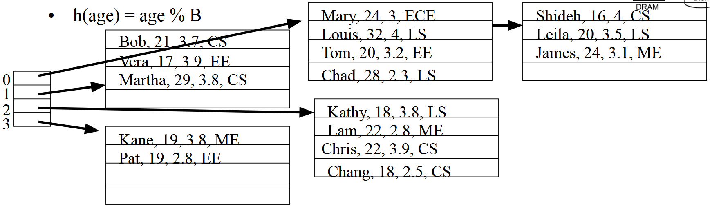

* Clustered: The leaf nodes contain full data. When looking for a record, we don't need to do another I/O after reaching the leaf nodes of the index tree.
* Overflow bucket.
* More difficult to maintain.
* Special case: When the searching predicate we use is different from the predicate used for index, the searching can be more difficult than linear scan (original: 4 buckets -> now: 5 buckets, include an overflow one).

#### B+ tree

Suitable for processing **range predicates**.

**[Non-clustered secondary B+ tree]**

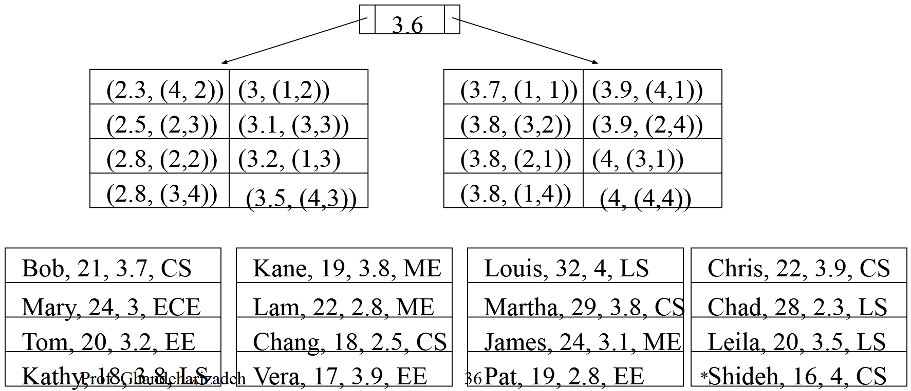

**[Non-clustered primary B+ tree]**

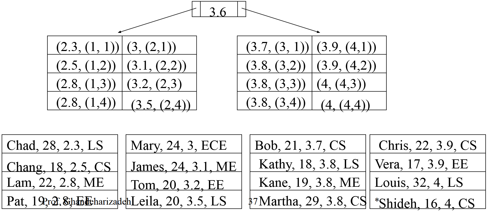

* **Primary**: The data file is sorted based on the indexed attribute.
* If we want students with gpa > 3.9: Find the leaf node of 3.9 on the index tree -> Find the record on the data file -> Read behind this record and get all students with gpa > 3.9 (don't need to look up the index tree again).

**[Clustered B+ tree]**

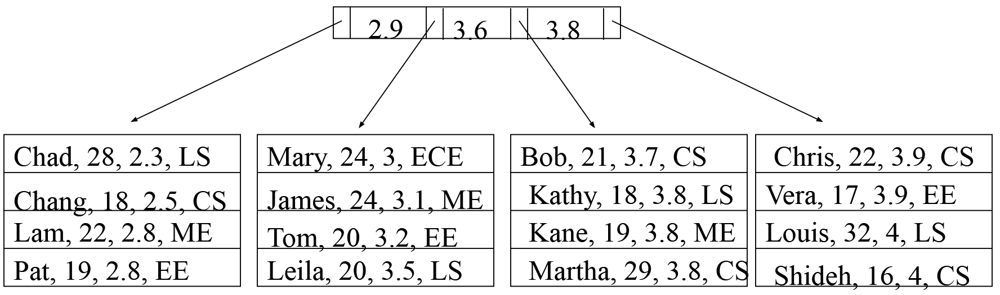

## Motivation

A query that processes a few disk pages should be processed by less nodes.

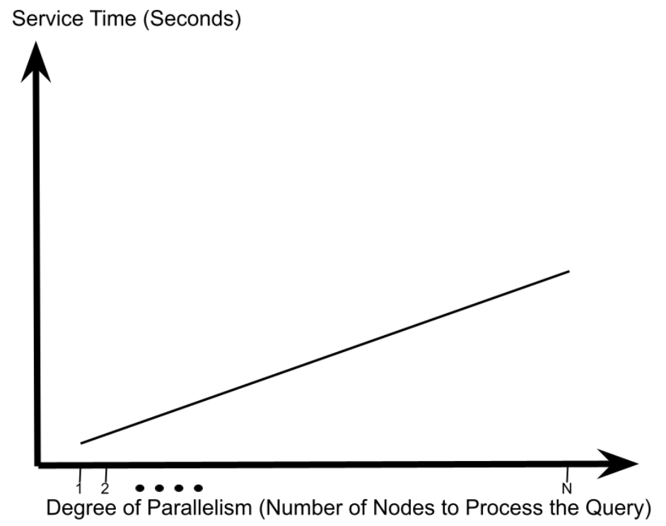

* The index can process efficiently. If we only need one record on one disk page but direct the query to N nodes, N-1 nodes will search their index to find no qualifying record.

A query that processes many disk pages should be processed by more nodes.

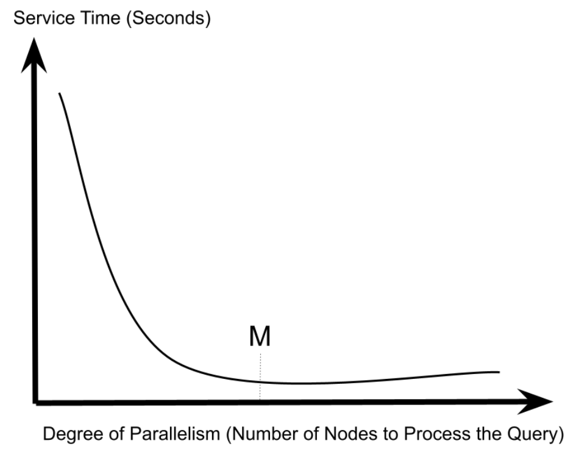

* If using only a few nodes, one node has to deal with large workload, while others only stay idle.
* Why increase beyond M? -- Overhead of parallelism.

HRPS was developed to strike a compromise, providing good performance for both types of queries by **obtaining the appropriate degree of parallelism based on the query's characteristics**.

## Core Mechanism

**What to achieve?**

Execute range queries with minimal resource requirements on a single processor while directing CPU and/or I/O intensive queries to a large number of processors.

**The key factor to decide?**

How many tuples **each fragment** of a relation should contain.

**The factors need to take into consideration?**

* The **resource requirements** of the queries accessing the relation
* The processing capability of the system
* **The overhead of using each additional processor to execute a query**
* The cost of **searching the range table** constructed by the hybrid-range declustering strategy (important when execution time is short)

### M = Desired Degree of Parallelism for a Query

**The first step is to decide the degree of parallelism (M) we want to get (no matter of how many servers we got).**

$$ RT(M)=\frac{CPU_{Ave}+Disk_{Ave}+Net_{Ave}}{M}+M\cdot CP $$

**M** is the first derivative of the function:

$$ M=\sqrt{\frac{CPU_{Ave}+Disk_{Ave}+Net_{Ave}}{CP}} $$

If the relation is declustered across M processors, the response time for $Q_{ave}$ will be minimized.

> For each query **Qi**, the workload defines the **CPU processing time** ($CPU_i$), the **Disk Processing Time** ($Disk_i$), and the **Network Processing time** ($Net_i$) of that query.
>
> RT(M): The **response time (RT)** of a query in terms of **the number of processors (M)**
>
> $Q_{ave}$: An average query, representative of all the queries in the workload
>
> $ExecutionTime (Q_{ave}) = CPU_{Ave}+Disk_{Ave}+Net_{Ave}$
>
> CP: The **overhead** with using an additional processor

**M: The number of processors that should participate in the execution of $Q_{ave}$/ each query.**

### FC = Fragment Cardinality

**The next step is to determine the size of fragment (how many tuples in each fragment, FC).**

$$FC=\frac{TuplesPerQ_{ave}}{M}$$

The **total number of fragments** is the relation's cardinality (how many tuples are in this relation) divided by FC.

**Finally**, the **fragments** are distributed among the processors in a **round-robin** fashion, insuring that M adjacent fragments will be assigned to different processors (unless N, the number of processors, is less than M).

#### Comparison of M and N

Range table: the information about the assignment of fragments to processors.

> M: desired level of parallelism
>
> N: number of processors

**[M = N]**

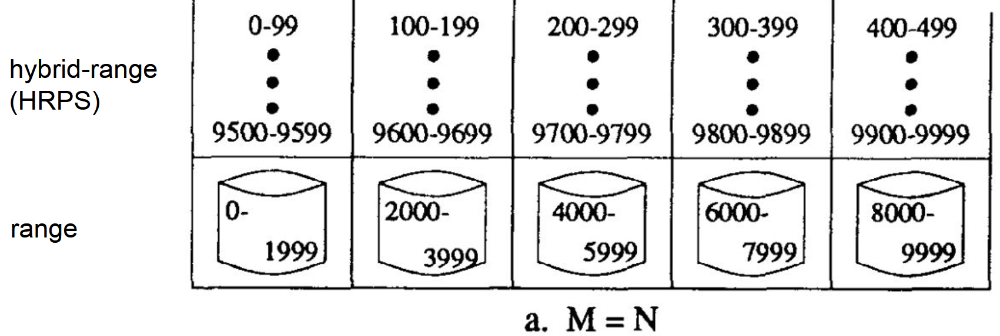

When we need id < 500, range partitioning will only use only node, while HRPS will have 5 nodes working together.

**[M > N]**

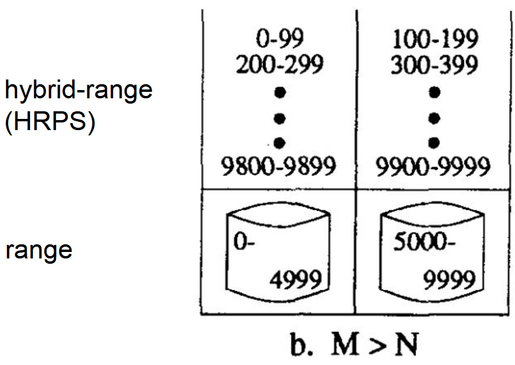

RP: 1 node, HRPS: 2 nodes

**[M < N]**

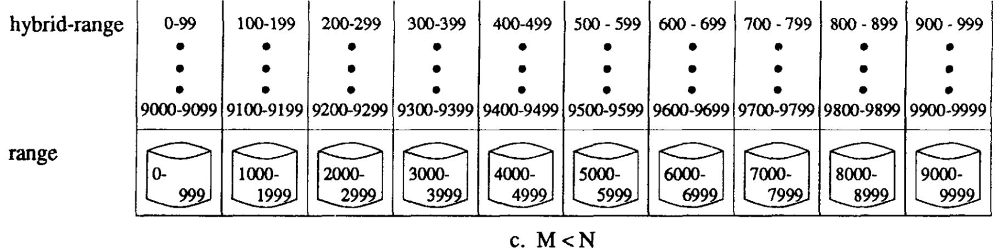

Hash: send the query to all N processors (unnecessary cost in startup, communication, and termination overheads associated with more processors).

HRPS: 5 nodes (better parallelism, superior response time, better throughput).

### Discussion: the overhead of searching a directory

For each relation, the HRPS creates a one dimensional directory that specifies **the range of each fragment and the mapping of**
**fragments to processors**.

If the resource requirements for this query are low, the overhead of **searching the one dimensional directory** might become a
significant fraction of the query’s execution time.

**Number of fragments (F):**

$$ F = \frac{Cardinality(Rel)}{FC} = \frac{Cardinality(Rel) \times M}{TuplesPerQ} $$

**The cost of searching the one dimensional directory:**

* Linear search: $$ RT(M) = \frac{CPU + Disk + Net}{M} + M \cdot CP + F\times CS = \frac{CPU + Disk + Net}{M} + M \cdot CP + \frac{M \cdot Cardinality(Rel) \cdot CS}{TuplesPerQ} $$

  > CS: the overhead associated with searching a single entry in the directory

* Binary search: $$ RT(M) = \frac{CPU + Disk + Net}{M} + M \cdot CP + CS \cdot log_2F = \frac{CPU + Disk + Net}{M} + M \cdot CP + CS \cdot \log_2\left(\frac{Cardinality(Rel) \cdot M}{TuplesPerQ}\right) $$

**The result of parallelism:**

* Linear search: $$ M = \sqrt{\frac{CPU + Disk + Net}{CP + \frac{Cardinality(Rel) \cdot CS}{TuplesPerQ}}} $$
* Binary search: $$ M = \frac{-\frac{CS}{\ln 2} + \sqrt{\left(\frac{CS}{\ln 2}\right)^2 + 4 \cdot CP \cdot (CPU + Disk + Net)}}{2 \cdot CP} $$

### Multi processor

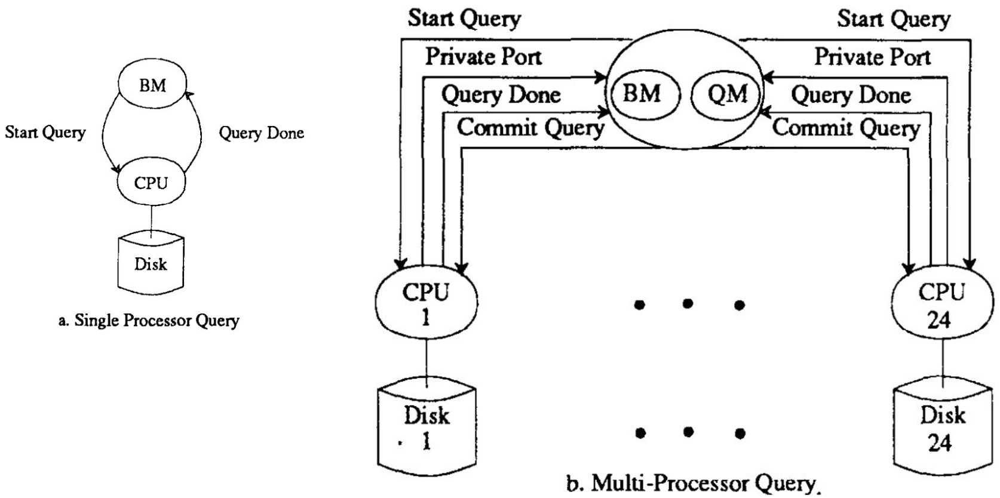

* Single node: only two messages are needed: Start Query and Query Done.
* Multi nodes: each participating node must receive **Start Query**, report its **Private Port**, send **Query Done**, and finally receive **Commit Query** from the Query Manager. This coordination cost grows with the number of participating nodes, which is the M × CP term in RT(M). Therefore, small queries should run on a single node, while only large queries benefit from using many nodes.

## Performance & Comparison

### Examples

**Range Query: Fetch 10 Records Using a Clustered B+-tree Index**

> Multiprogramming Level (MPL): How many queries are occurring in the system (or how many users)

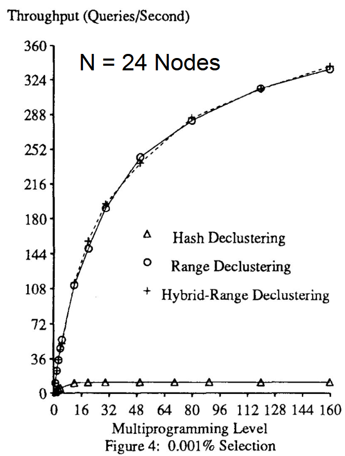

> HRPS constructs 5700 fragments.

* The throughput with hash declustering is very low, with multiprogramming level increasing
  * The query is directed to all the nodes
  * At least 14 nodes search for nothing, just wasting their resource
  * Since every query needs all the nodes, the system cannot scale (two queries almost cannot do together)
* Range/Hybrid Range Declustering can direct these 10 records to one node
  * Throughput increases almost linearly for 0-12
  * Level off after 12 -- The requests are colliding (certain queries might be directed to the same node). Random distribution doesn't mean the queries will distribute evenly on the nodes.

**Range Query: Fetch 10K Records Using a Clustered B+-tree Index**

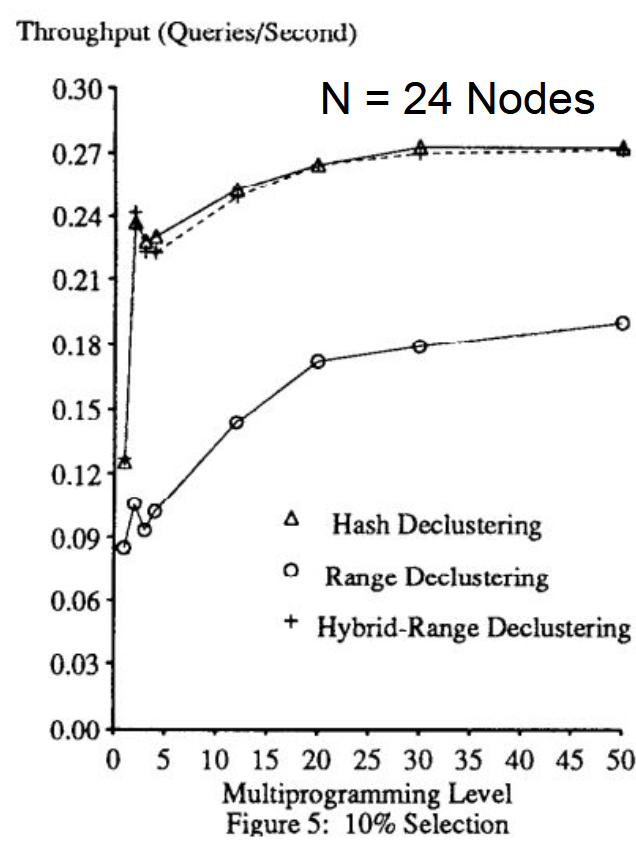

> M=90, HRPS constructs 895 fragments. Range constructs 24 fragments.

* HRPS and Hash will deliver the query to 24 nodes, while Range Declustering will only deliver the query to 3 nodes -> lots of work for the system -> lower throughput compared with Hash and Hybrid-Range
* Why throughput decrease at about 2? -- If two queries are assigned to the same node, the disk cache (SCSI cache) will be interfered and become ineffective.
  * Disk cache: When reading continuous pages, the next page will be put into the disk cache in advance.
  * Why this trend does not appear in 10 records? -- For 10 records, the prefetch is useless, because the query is very selective.
* When MPL increase, nodes will be fully utilized. After a certain point, queries collide, so the increase level off.

**Mixed Workload: one-half 0.0001% selection + one-half 10% selection**

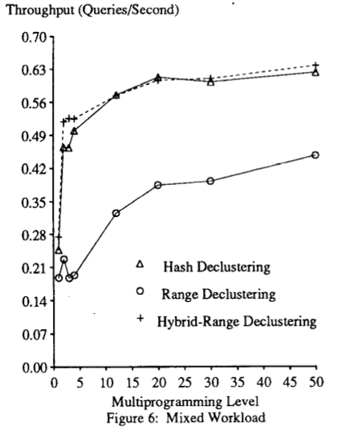

* HRPS: use single node for 0.0001% selection, all nodes for 10% selection, Hash: use all the processors for both queries, Range: 0.0001% selection to one node, 10% selection to 3 nodes
* Hash and HRPS outperform Range -> the execution of the 10% selection dominates the computation of the average throughput
* After multiprogramming level reaches 4, the difference between Hash and HRPS is limited -> 10% selection dominates

**Mixed Workload: multiprogramming level=50, percentage of each selection varies**

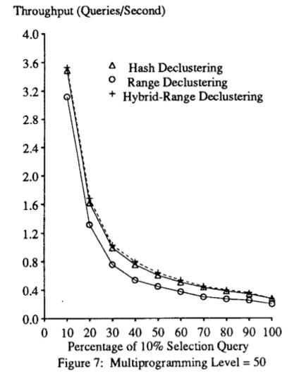

* With more than 10% of 10% selection query, Hash and HRPS are almost the same.

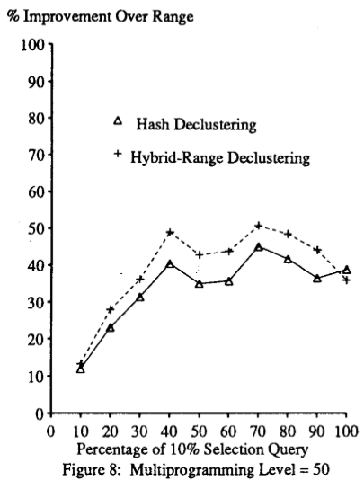

* The percentage improvement in throughput provided by Hash and HRPS relative to Range: From x=10%, Hash & HRPS outperform Range by an increasing widening margin.
* Levels off at x=40%: the disk has become 100% utilized.

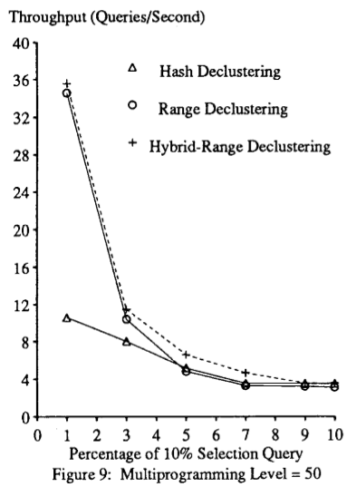

* Before x=5%, Range outperforms Hash. Between 5%~7%, HRPS is apparently the best.

### Other Features

* Support for small relation
  * F = Cardinality(Rel) / FC, a small table may have fewer fragments than nodes.
  * Only need a subset of nodes for work, avoiding the coordination overhead of involving all N nodes (M × CP).
* Support for tables with many duplicates for the partitioning attribute value
  * The number of records are approximately the same in each fragment of HRPS.
  * HRPS will construct multiple **duplicate ranges**, assigning duplicates to different node.
  * For Hash and Range, records with the same keys will be assigned to the same nodes -> one node might need to do a lot of work (**data skew**) -> bottle neck

### Shortcomings

* For hardware platform that is heterogeneous: The RT(M) equation used in HRPS assumes all nodes are the same. It is more suitable for the fast nodes to process more tuples.
* More than one attributes might be needed to partition the data...