# Strong Consistency in Cache Augmented SQL Systems

> Week 11: [Strong consistency in cache augmented SQL systems | Proceedings of the 15th International Middleware Conference](https://dl.acm.org/doi/10.1145/2663165.2663318)


## Background & Motivation

For some apps (e.g. social media apps), an important challenge is high volume of requests with a low latency requirement.

The RDBMSs is very slow / bloated: lots of overhead from logging / locking / latching / buffer manager ...

However, for a key-value cache (e.g. Redis, Memcached): Only network protocol for key-value transmission; No buffer pool manager; No logging; No locking -> faster response

> When cache is full, it will quietly evict data.


### Cache Augmented DBMSs

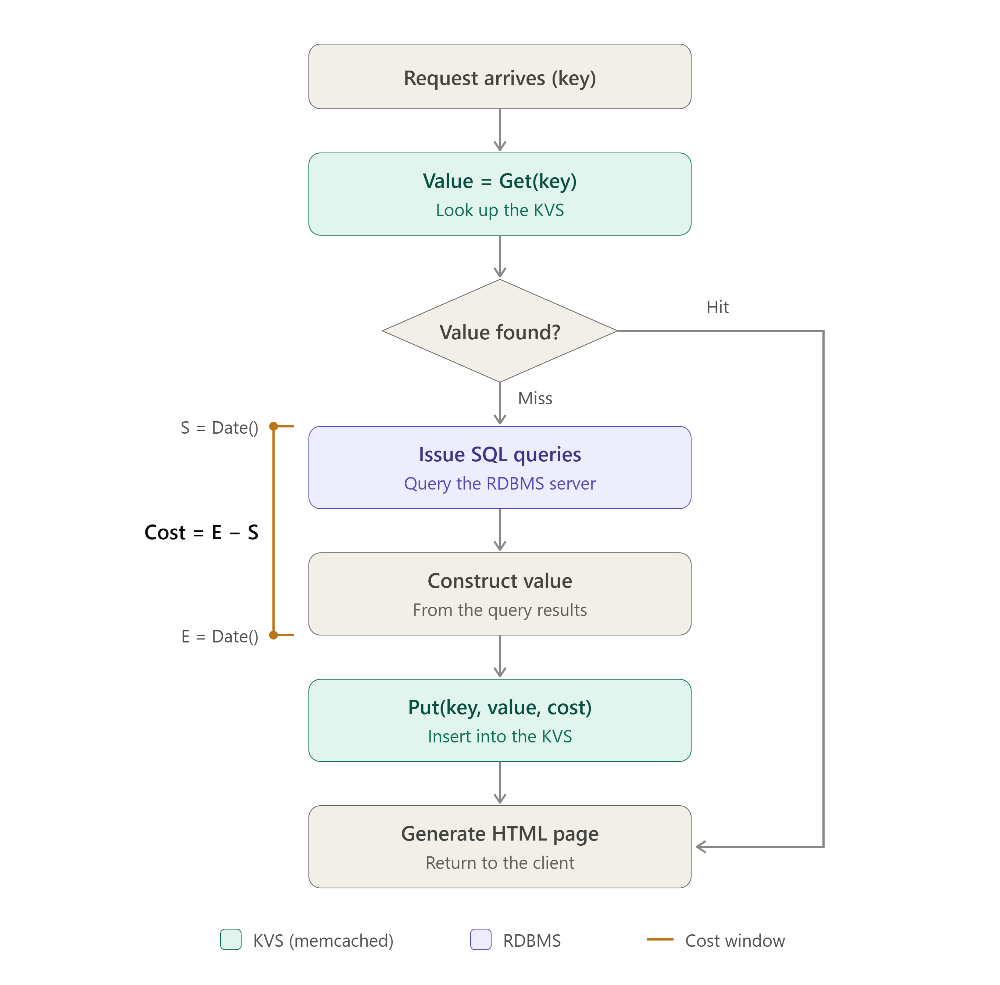

> The more writes, the less benefit we can get from cache: The overhead of maintaining the cache consistent with the database management system is the overhead that diminishes the benefit of the cache.


### Cache Update

> * DML (SQL Data Manipulation Language): insert, delete, update
> * Session: A session is a sequence of RDBMS operations as one transaction followed by one or more KVS operations. The order doesn't matter.

Three approaches to update the KVS (cache): **Invalidate, Refresh, or Incrementally update**.

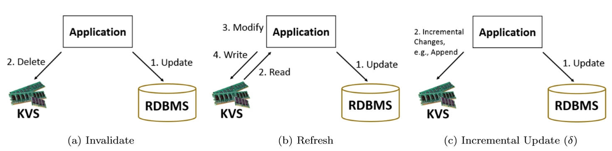

* **Invalidate.** On a DML update, the application computes the impacted key and deletes it from the KVS. The next read observes a miss, queries the RDBMS (the source of truth), and repopulates the cache. It is the simplest technique but the least power-efficient. Delete the key *before* the RDBMS transaction: if the app dies after the delete, the next read just misses and recovers; if it deletes after commit and dies in between, a stale value stays in the cache. Deleting is always safe because the cache is only a subset of the RDBMS, and multiple deletes on the same key do not conflict because delete is idempotent.
* **Refresh:** Read the key from the KVS, **modify it in the app**, and write it back (R-M-W), alongside the RDBMS update (in either order). Needs extra logic but is more power-efficient. A failure between the two steps makes the cache diverge from the RDBMS.
* **Incremental update (δ):** Send the change itself to the KVS (increment, append, etc.), similar to SQL UPDATE. The KVS must support the operation. It has the same failure risk as refresh.


**[Example -- Invalidate]**

```text
Invite Friend(InviterID, InviteeID)
1. Key = "Profile"+InviteeID
2. KVS.Delete(key)
3. Begin RDBMS Xact
a. Insert(InviterID, InviteeID, 1) in PendingFriends
b. Update PendingFriendCount of InviteeID by 1 in the Users table
4. Commit Xact
```

**Q: Does it matter if the KVS delete (Step 2) is placed after Step 3, i.e., after the RDBMS transaction?**

Yes.

**Transaction, then delete:** If the app crashes after the commit but before the delete, the stale value stays in the cache, and every later read hits it.

**Delete, then transaction:** If the app crashes after the delete, there is no harm. The next read misses and reloads the correct value from the RDBMS.


**[Example -- Refresh / Refill]**

```text
Invite Friend(InviterID, InviteeID)
1. Key = "Profile"+InviteeID
2. Vold = KVS.Read(Key)
3. Vnew = Increment Vold.#PendingFriends by 1
4. KVS.Write (Key, Vnew)
5. Begin RDBMS Xact
a. Insert(InviterID, InviteeID, 1) in PendingFriends
b. Update PendingFriendCount of InviteeID by 1 in the Users table
6. Commit Xact
```

* The modification happens in the app, not in the KVS.

* If the app crashes after writing the KVS but before the RDBMS transaction, the cache holds a change that never reached the database, so the cache diverges from the RDBMS.

* 2~4: Read - Modify - Write, **RMW**


**[Example -- Incremental Update]**

```text
Invite Friend(InviterID, InviteeID)
1. Key = "Profile"+InviteeID
2. KVS.Increment(Key, 1)
3. Begin RDBMS Xact
a. Insert(InviterID, InviteeID, 1) in PendingFriends
b. Update PendingFriendCount of InviteeID by 1 in the Users table
4. Commit Xact
```

* The KVS applies the change itself, similar to SQL `UPDATE … SET count = count + 1`. The app sends only the change, never the whole value.
* Failure risk: Same as refresh.

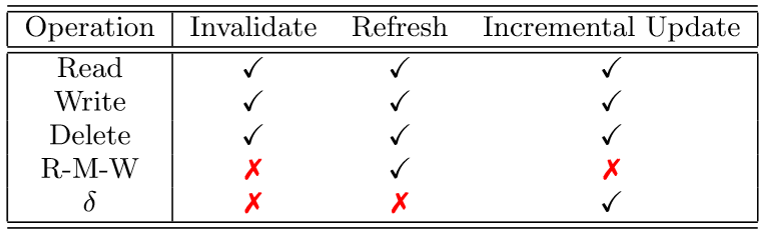


## Consistency

**Example: undesirable race conditions**

> Administrator wants to delete Alice's member profile, while Alice wants to log in.

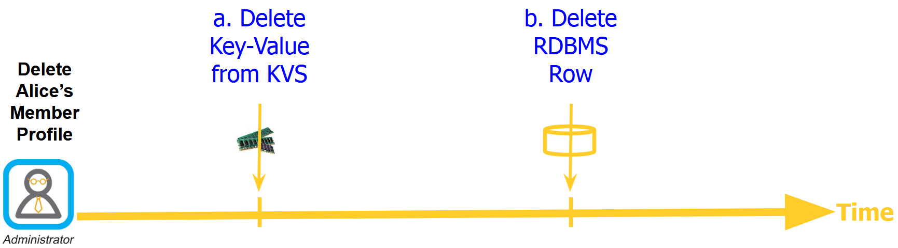

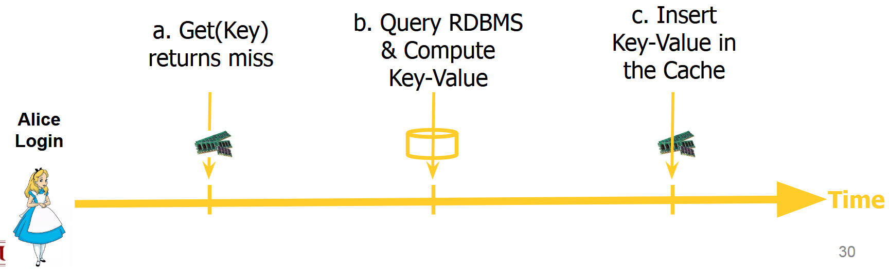

For serial execution of Xacts 1&2: no problem.

**Stale data from race condition:**

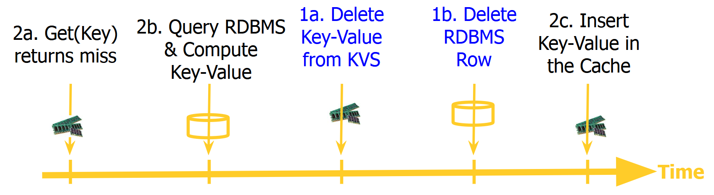

At the end of this schedule, Alice exists in the cache with no record in the RDBMS. Subsequent look ups for Alice observe cache hits, producing stale data.

**Stale data from snapshot isolation:**

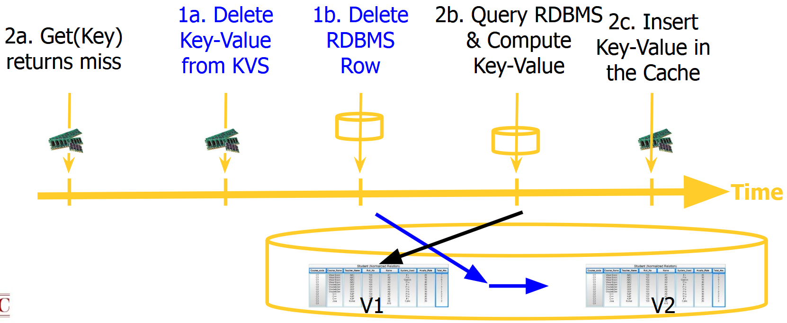


Alice’s query (2b) reads the old version V1, which still contains her record, while the admin’s delete creates V2. Alice then inserts this stale value into the cache (2c).

The RDBMS itself is correct, since it produced a valid serial schedule. The cache, however, doesn’t know which order the RDBMS chose, so it ends up holding data that no longer exists in the database.


### Compare-and-Swap (cas)

Prior to writing the value of a key, **verify that its value has not changed since it was read**. With R-M-W, W using cas provides the old value and new value for the key. The key is updated only if its current value equals the old value. Otherwise, the W fails.

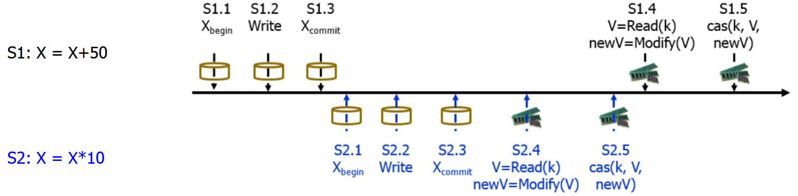

| Step | Action                                                       | RDBMS X  | Cache X  |
| ---- | ------------------------------------------------------------ | -------- | -------- |
| Init |                                                              | 100      | 100      |
| 1    | S1 updates RDBMS: 100 + 50                                   | **150**  | 100      |
| 2    | S2 updates RDBMS: 150 × 10                                   | **1500** | 100      |
| 3    | S2 reads 100 from cache, computes 1000, `CAS(100, 1000)` succeeds | 1500     | **1000** |
| 4    | S1 reads 1000 from cache, computes 1050, `CAS(1000, 1050)` succeeds | 1500     | **1050** |

**Why it fails:**

- The RDBMS serializes S1 → S2, giving 1500. The cache serializes S2 → S1, giving 1050.
- Both CAS calls succeed because the two R-M-Ws on the cache don’t overlap, so neither sees a concurrent change.
- **CAS only detects conflicts *within the cache*.** It cannot force the cache to follow the RDBMS’s serial order, so the two diverge.


### IQ's solution: Modify the KVS only

#### Session

* A session is a sequence of operations consisting of **at most one RDBMS transaction** and one or more KVS operations.
* A **read session** reads the value of one key. If it observes a miss then it queries the database to construct the value of the key and inserts the (key, value) in the cache.
* A write session performs an RDBMS write operation that may impact one or more key-value pairs, e.g., with invalidate, the session **deletes the impacted key-value pairs from the KVS**.
* A session should **observe its own updates**. However, a session's updates should not be visible to other sessions until it commits.


#### IQ Framework - Invalidate

**Two leases:**

* **Inhibit (I):** The KVS grants an I lease to a session that observes a KVS miss, enabling it to **query the RDBMS and populate the KVS with a key-value pair**. The KVS grants at most one I lease on a key. Hence, at most one session may query the RDBMS to populate the KVS. All other concurrent read sessions referencing the same key must back off and try again.

  ```mermaid
  flowchart LR
      A["Get(key):<br/>cache miss"] --> B["KVS grants<br/>I lease"]
      B --> C["Query RDBMS,<br/>construct value"]
      C --> D["Populate KVS<br/>with I lease"]
  ```

* **Quarantine (Q):** A session that intends to either **write, delete, δ, or R-M-W one or more keys** must obtain a Q lease on each key explicitly. When a Q lease request for a key encounters an existing I lease held by a read session, S<sub>R</sub>, the IQ framework **invalidates the I lease** of S<sub>R</sub> to grant the Q lease. Subsequently, when S<sub>R</sub> writes its computed value to the KVS, the KVS ignores its write operation because its I lease is no longer valid. Also effective for **snapshot isolation**.

  ```mermaid
  flowchart LR
      A["S_R holds<br/>I lease on key"] --> B["Write session<br/>requests Q lease"]
      B --> C["KVS voids I lease,<br/>grants Q lease"]
      C --> D["S_R writes<br/>computed value"]
      D --> E["KVS ignores write<br/>(I lease invalid)"]
  ```

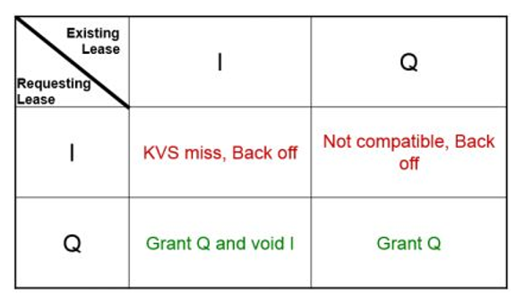

**Example:**

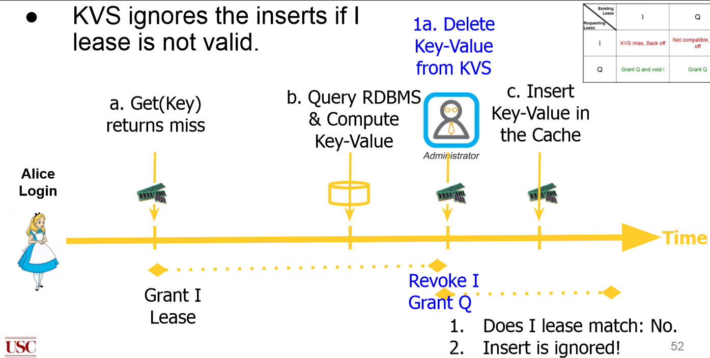

When Alice’s Get misses, she is granted an I lease. Before her insert arrives, the administrator’s delete (1a) requests a Q lease on the same key, which voids her I lease. Her insert (c) then carries an invalid lease, so the KVS ignores it, and Alice’s stale entry never enters the cache.


**[Difference between Lease and Lock]**

A **lock** is meant for **centralized systems**: the holder must release it, so if the application crashes, the lock stays in effect indefinitely. A **lease** is meant for **distributed systems**: it has a finite lifetime, so if the holder crashes, the KVS automatically releases it on expiry and other sessions can proceed. This matters most for Q leases with refresh and δ, since holding them indefinitely would let node failures or flaky networks severely degrade performance.


**[What happens when the life time of a lease is too short or too long?]**

- **Too short:** The lease expires before the reader finishes querying the RDBMS, so its insert is ignored even though there’s no race. As a result, the cache stays empty.
- **Too long:** The lease behaves like a lock. If the holder crashes, the key is unavailable for the entire lifetime.


**[How is the I-Lease implemented?]**

Lease handling is hidden inside the KVS client, so the application only calls plain `get`/`set`. On a miss, the IQ-Server returns **a token (the I lease)**, which the IQ-Client stores in a hash table (cache key → token). On `set`, the IQ-Client attaches the token automatically, and the IQ-Server writes the value only if the token still matches.

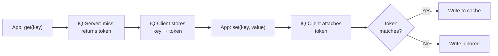

**[When is the Q lease released?]**

A write session must commit explicitly to release its Q leases; otherwise they are released when they time out. Read sessions don’t need an explicit commit.


#### IQ Framework - Refresh

**Refresh: Write Session Rules**

1. **Before commit:** Obtain a Q lease on every key the session intends to update.

2. **After commit:** **Write the updated key-value pairs to the KVS** and release the Q leases at session commit.

3. **On Q lease expiry:** The KVS deletes the key-value pair.

   > e.g., a session losing its network connection mid-write; the deleted key causes at most a miss, never inconsistency.


**[Two Phase Locking]**

* **Quarantine-and-Read, `QaRead(key)`**
  * Acquires a Q lease on the referenced key from the server and reads the value of the key (if any).
  * If another session has a Q lease on the key then the requesting session aborts and retries.
* **Swap-and-Release, `SaR(key, vnew)`**
  * Issued after RDBMS transaction commit.
  * Changes the current value of the specified key with the new value, $v_{new}$, and releases its Q lease.

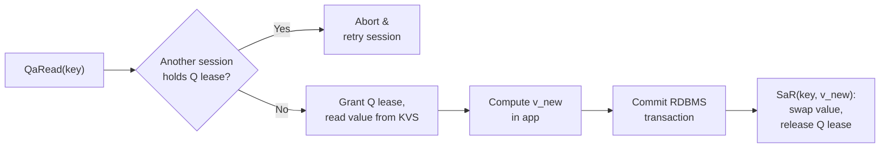

**Once S1 holds a Q lease, a reader S2 can never see S1’s uncommitted value:**

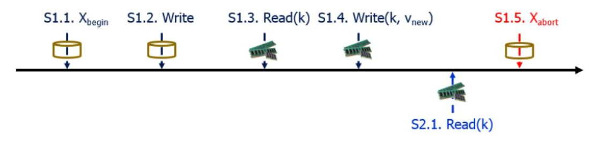

- Cache hit: S2 reads the old value, since S1 writes only after commit. S2 is serialized before S1.
- Cache miss: S2’s I lease request conflicts with S1’s Q lease, so S2 backs off until S1 releases it.

**When to Call QaRead?** Calling QaRead ***during* the RDBMS transaction** is better than calling it *before*. Q leases are then held for a shorter time, since the session doesn’t wait for the slow RDBMS while holding them, so conflicts and session restarts drop sharply and write sessions don’t starve.


#### IQ Framework -- Incremental Update

- **IQ-δ(k_i, δ_i):** Δ is the incremental operation (e.g., append, increment), and δ_i is the change (e.g., the value to append). It acquires a Q lease like QaRead and aborts on a Q–Q conflict.
- **Buffering:** The KVS buffers δ_i and keeps k_i’s old value.
- **Commit:** The KVS applies δ_i to k_i’s value.
- **Abort:** The KVS discards δ_i.
- **Effect:** Before commit, readers see the old value, so they are serialized before the write session.


## Evaluation

Without IQ, Twemcache produces stale data under concurrent load, especially with refresh, where stale values stay stuck in the cache (~3% with 100K members). IQ reduces stale data to zero with no noticeable performance overhead.