# In Search of an Understandable Consensus Algorithm

> Week 12: [raft-atc14](https://web.stanford.edu/~ouster/cgi-bin/papers/raft-atc14)

## Background

* **Consensus algorithm**

  * Allows collection of machines to work as coherent group
  * Continuous service, even if some machines fail
  * Previous: **Paxos**

* Problems of Paxos:

  * Hard to understand
  * Not complete enough for real implementations

* Focus of Raft: understandability, implementation

  * How to improve understandability? 1. Decomposition (Raft separates leader election, log replication, and safety); 2. State space reduction (fewer possible states to reason about, e.g., logs can’t have holes; limit how logs can become 

    inconsistent)

## Replicated State Machines

**\> What is the problem Raft is going to solve?**

### State machine

State machine: a program that receives commands (requests) from clients, updates its internal state, and returns results.

* Deterministic: same commands in the same order → same state and same outputs
* How to make it reliable? -> replicate, run on several machines together

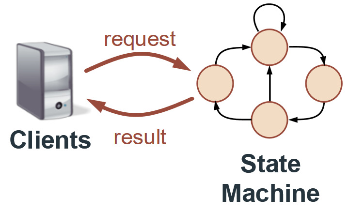

### Replicated state machine

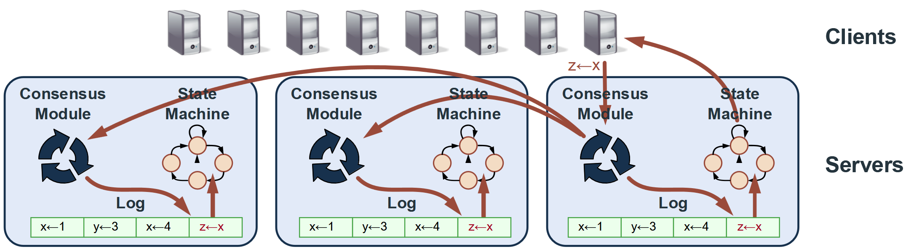

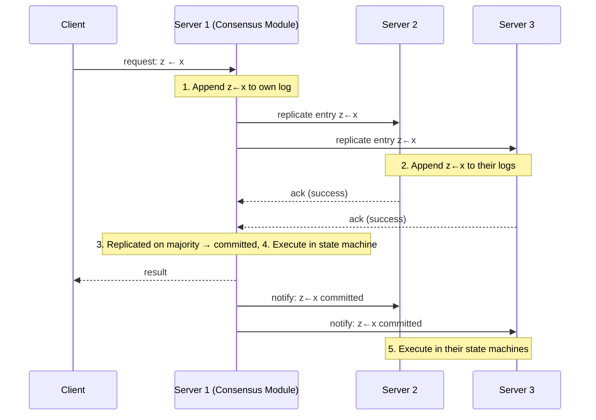

* **Consensus module**: keeps the replicated log consistent across servers, even if some servers fail
* Available as long as any **majority of servers** are up and can communicate (2f+1 servers tolerate f failures, e.g., 5 servers tolerate 2)
* Failure model:
  - **Fail-stop**: a failed server simply stops working; it doesn’t send wrong or malicious messages, and may later recover from disk and rejoin the cluster
  - Non-Byzantine: Raft assumes all servers are honest
* Safety doesn’t depend on timing: bad clocks or long message delays can only hurt availability, not correctness

## Algorithm

### Raft basics

#### Raft decomposition

1. Leader election:
  * Select one server to act as leader
  * Detect crashes, choose new leader
2. Log replication (normal operation)
  * Leader accepts commands from clients, appends to its log
  * Leader replicates its log to other servers (overwrites inconsistencies: if there's a difference between leader's and other's logs, then the leader forces others to agree with its own)
3. Safety
  * Keep logs consistent
  * Only servers with up-to-date logs can become leader

#### Server states and RPCs

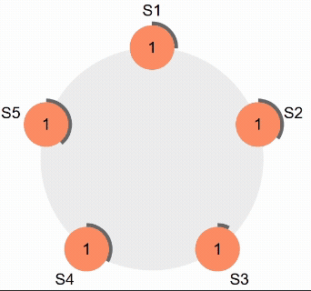

**Three states:**

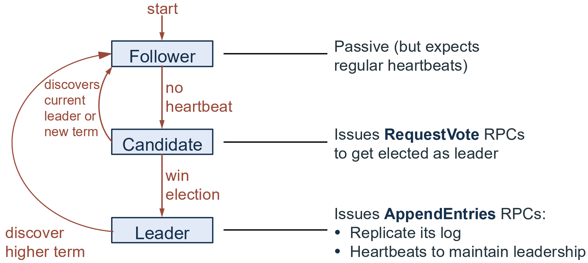

Only two kinds of RPCs in Raft: `RequestVote` RPC + `AppendEntries` RPC

**Terms:**

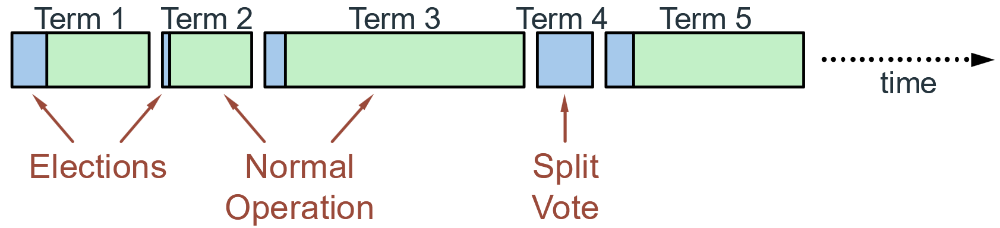

* Each term begins with an election → if successful, one leader runs normal operation for the rest of the term
* At most 1 leader per term; some terms have no leader (split vote)
* Purpose: terms act as a logical clock and **identify obsolete information** (e.g., a stale leader)
* Each server keeps its own `currentTerm` (no global view)
* Rules (`currentTerm` is exchanged in every RPC):
  - Peer has a higher term → update own term, revert to follower
  - Incoming RPC has a stale term → reject it

### Leader election

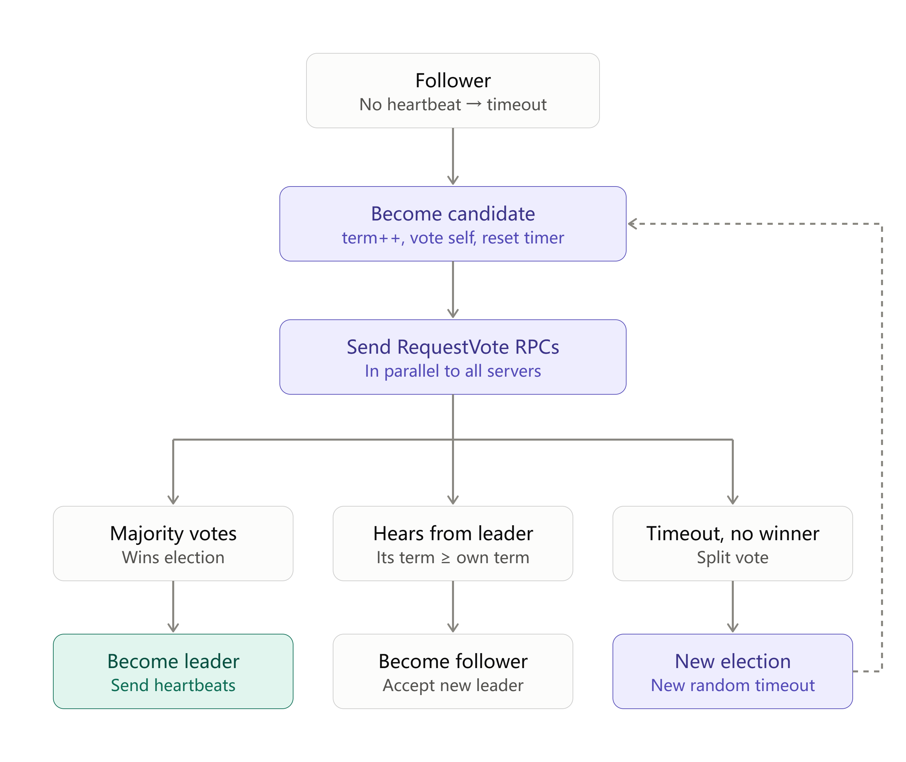

#### Election correctness

* **Safety >> something bad never happens** -> allow at most one winner per term
  * Each server gives only one vote per term (persist on disk: if this node fails, it won't forget and vote again)
  * Majority required to win election
* **Liveness >> something good eventually happens** -> some candidate must eventually win
  * **Choose election timeouts randomly** in [T, 2T] (e.g. 150-300 ms) -> One server usually times out and wins election before others time out (prevent split vote)
  * Works well if T >> broadcast time

### Log replication

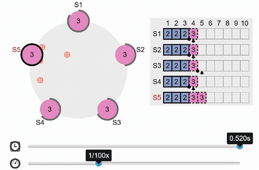

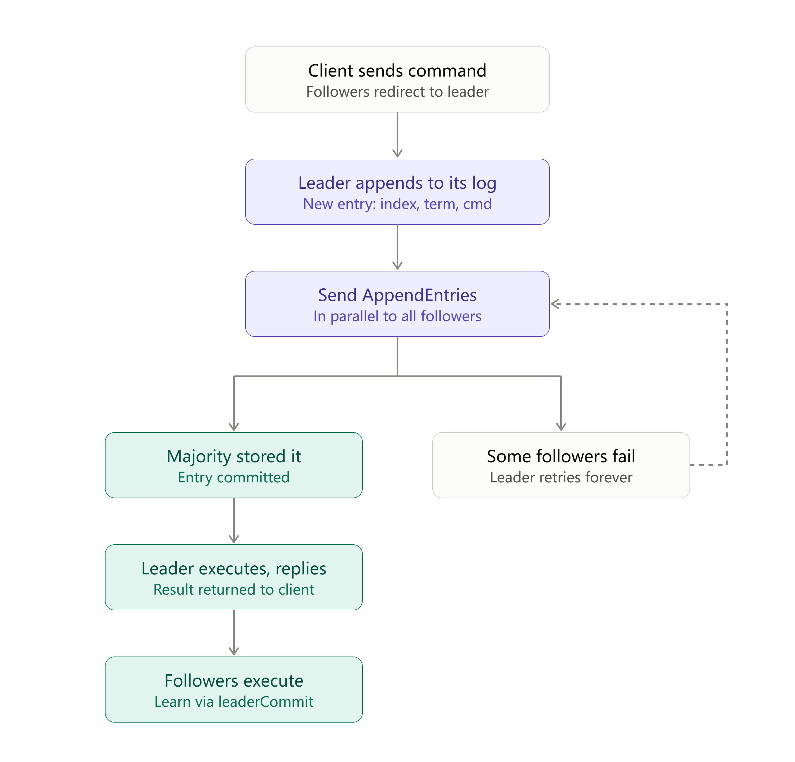

* Once new entry committed:
  * Leader executes command in its state machine, **returns result** to client
  * Leader **notifies** followers of committed entries in subsequent `AppendEntries` RPCs
  * Followers **execute** committed commands in their state machines
* Leader retries `AppendEntries` RPC for crashed/slow followers, until they succeed
* Leader won't be interfered by slow followers

#### Log structure

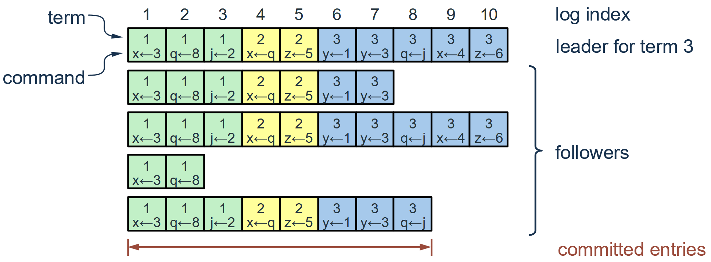

* In a log: index, term, command
* Log must survive crashes (store on disk)
* Entry committed if safe to execute in state machines
  * Replicated on majority of servers by leader of its term
* Committing an entry also commits **all preceding entries** in the leader’s log (including entries created by previous leaders)
* Committed entries are durable and will eventually be executed by all available state machines

#### Log inconsistencies

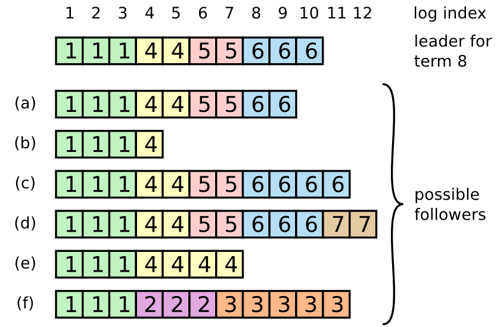

* **Missing entries** (a, b)
* **Extra uncommitted entries** (c, d)
  * Two possible causes: the follower was a leader itself and appended entries, or it received entries from a leader that crashed before replicating them to a majority
  * These entries must be uncommitted; otherwise the new leader would have them
* Both the two scenarios above (e)
* Scenario f possible reason: (f) was the leader for term 2 and appended several entries, but crashed before committing any of them. It then restarted quickly, became leader for term 3, and appended a few more entries, but crashed again before any of them were committed. It stayed down for several terms, so its entries from terms 2 and 3 conflict with the current leader’s log and will be overwritten.

#### Log Matching Property

**If log entries on different servers have same index and term:**

* **They store the same command**
  * Why true? A leader creates at most one entry per index in a given term, and entries never change their position in the log
* **The logs are identical in all preceding entries**
  * Why true? Guaranteed by the `AppendEntries` consistency check

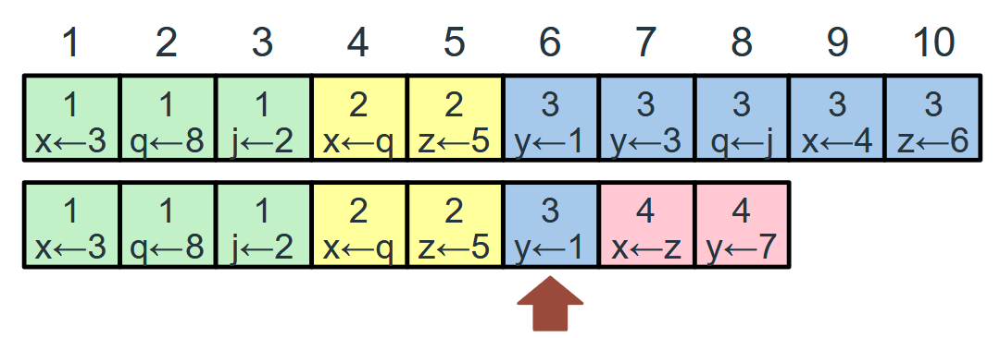

If a given entry is committed, all preceding entries are also committed.

#### `AppendEntries` consistency check

To bring a follower’s log into consistency with its own, the leader must find **the latest log entry where the two logs agree**, **delete any entries in the follower’s log after that point**, and send the follower **all of the leader’s entries** after that point.

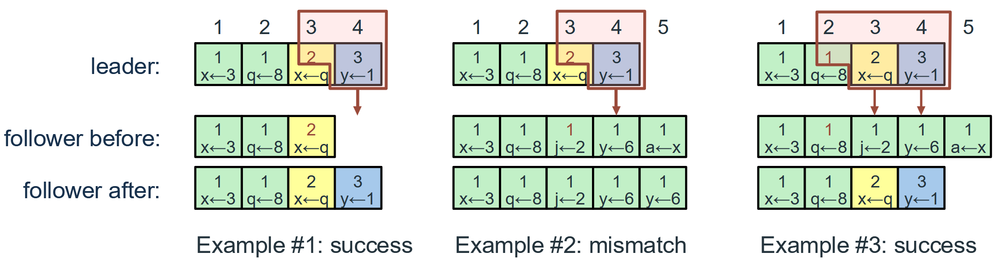

> - Example 1 (success): leader sends entry 4 with prev = <3, term 2>; follower’s entry 3 matches → accepts and appends entry 4
> - Example 2 (mismatch): leader sends prev = <3, term 2>, but follower’s entry 3 has term 1 → rejects, log unchanged
> - Example 3 (success after retry): leader retries with prev = <2, term 1> and sends entries 3–4; follower’s entry 2 matches → deletes its conflicting entries (3–5) and appends the leader’s entries 3–4

* The leader keeps a `nextIndex` for each follower (the next entry to send, initialized to its last log index + 1); each rejection decrements `nextIndex` and retries until the logs match, and once `AppendEntries` succeeds, the follower’s log stays consistent with the leader’s for the rest of the term.
* Why Log Matching Property is correct? Whenever `AppendEntries` succeeds, the leader knows the follower’s log is identical to its own up through the new entries

### Safety

**\> Adding restriction on which servers may be elected leader**

#### Leader Completeness

**Ensure that the leader have all committed entries.**

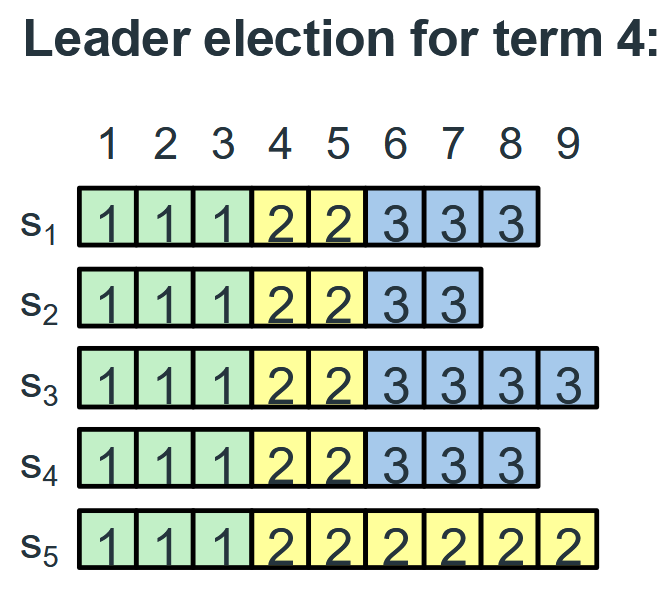

* Once log entry committed, all future leaders must store that entry.
* How to achieve that? **Election restriction:**
  * Candidates include **index and term of last log entry** in `RequestVote` RPCs
  * Voting server denies vote if its log is more up-to-date
  * Logs ranked by `<lastTerm, lastIndex>`
    * Compare term first, then index.
    * Larger index doesn't necessarily means more up-to-date -> case for s5

**Why the new leader must have all committed entries (majority overlap):**

1. A committed entry is stored on a majority of servers
2. A candidate must get votes from a majority to win
3. Any two majorities overlap → at least one voter has the committed entry
4. That voter only votes for a candidate whose log is at least as up-to-date as its own → the candidate must also have the entry

#### Committing entries from previous terms

**When can an entry be considered as committed?** -- A leader cannot conclude that an entry from a previous term is committed just because it’s stored on a majority.

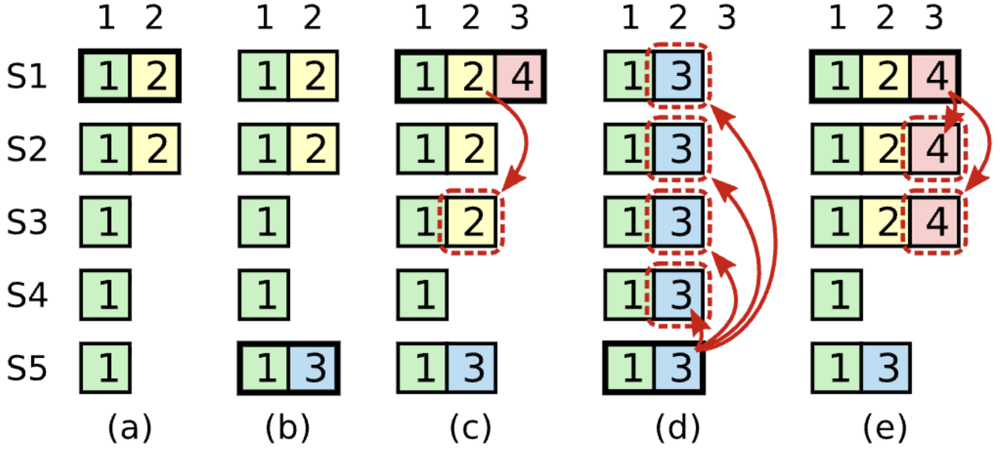

> - (a) **S1** is leader for term 2; appends entry at index 2 (term 2) and replicates it only to S2
> - (b) S1 crashes; **S5** is elected leader for term 3 (votes from S3, S4, S5) and appends a different entry at index 2 (term 3), but replicates it to no one
> - (c) S5 crashes; **S1** restarts, is elected leader for term 4, and continues replicating the term 2 entry → now on S1, S2, S3 (a majority), but NOT committed; S1 also appends a new term 4 entry at index 3
> - (d) If S1 crashes now: **S5** can be elected for term 5 (votes from S2, S3, S4, since its last term 3 > their last term 2 or 1) → overwrites index 2 on all servers with its term 3 entry → **the term 2 entry is lost even though it was on a majority**
> - (e) If instead S1 replicates its term 4 entry to a majority (S1, S2, S3) before crashing → that entry is committed, and S5 can no longer win (its last term 3 < 4) → the term 2 entry at index 2 is committed indirectly

* Rule: a leader only commits entries from its **current term** by **counting replicas**; earlier entries are **committed indirectly**
  * Committed indirectly: an older entry is never committed by counting its own replicas; it becomes committed when a later entry from the current term is committed (by Log Matching Property, all preceding entries are committed too)
* Raft keeps an entry’s original term number when replicating it → easier to reason about, fewer entries to resend

### Cluster membership changes

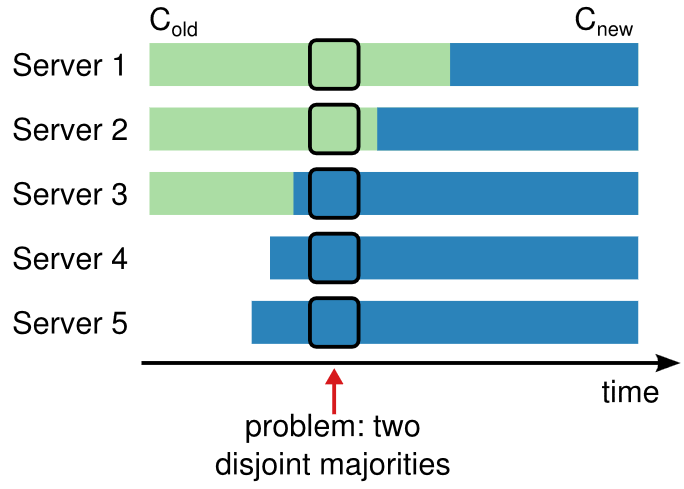

> - Cluster grows from 3 servers (C_old = S1–S3, majority = 2) to 5 servers (C_new = S1–S5, majority = 3)
> - Servers can’t switch configs at the same time: S1, S2 still use C_old, while S3, S4, S5 already use C_new
> - S1 wins with votes from S1, S2 (a majority of C_old); S5 wins with votes from S3, S4, S5 (a majority of C_new)
> - The two majorities don’t overlap → two leaders in the same term → so the change must use two phases (joint consensus)

#### Joint consensus

1. Log entries are replicated to all servers in both configurations
2. Any server from either configuration may serve as leader
3. Agreement (for elections and entry commitment) requires **separate majorities** from both the old and new configurations (e.g. 2 from S1-S3, and 3 from S1-S5)

**Pros:**

- Individual servers can switch configurations at different times without compromising safety
- The cluster can keep serving client requests throughout the configuration change

#### Timeline for a configuration change

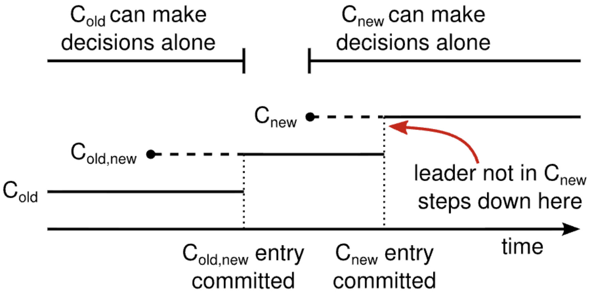

- Configs are stored as special log entries; a server uses the latest config in its log **as soon as it sees it**, even before it’s committed
- Timeline:
  - Leader creates the **C_old,new** entry and replicates it (dashed = created but not committed); during this time, decisions are made under C_old or C_old,new, never C_new alone
  - After **C_old,new** is committed: neither C_old nor C_new can decide alone (both majorities required); only servers with C_old,new can become leader
  - Leader then creates the **C_new** entry and replicates it; once C_new is committed, C_new can decide alone and servers not in C_new can be shut down
- A leader not in C_new steps down once C_new is committed (red arrow)
- **Key point: there is no time when C_old and C_new can both make decisions independently → no two leaders in the same term**

**Other details:**

1. New servers have empty logs → they first join as **non-voting members** (receive log entries but don’t count toward majorities) until they catch up
2. Leader not in C_new → steps down after C_new is committed (while committing C_new, it doesn’t count itself in majorities)
3. Removed servers may disrupt the cluster (they time out and send `RequestVote` with higher terms) → servers ignore `RequestVote` **if they’ve heard from a current leader within the minimum election timeout**

## Evaluation

- Understandability: a user study showed students understood Raft better than Paxos, and most felt Raft would be easier to implement and explain
- Performance: similar to Paxos; in the common case, a new entry needs only one round of RPCs to a majority of servers
- Leader election: a small amount of randomness in election timeouts is enough to avoid split votes and elect a leader quickly