# The Entity-Relationship Model - Toward a Unified View of Data

> week1: [The Entity Relationship Model — Toward a Unified View of Data | Springer Nature Link](https://link.springer.com/chapter/10.1007/978-3-642-48354-7_7)

## Entity-Relationship (E-R) Model

* Level 1: Conceptual data model: Entities, Relationships, Values
* Level 2: Representation of conceptual objects

### Two primitives of E-R model

1. **Entities**: objects that exist and are distinguishable from one another. These objects might be abstract, e.g., SF-49ers, Joe, Bob, etc.
2. **Relationships**: two or more entities may participate in a relationship, e.g., Joe is a fan of SF-49ers, etc.

**[Entity]**

* An entity is represented by a set of **attributes**

* An attribute is a **function** that maps an entity into a domain

  > domain, e.g. integer

  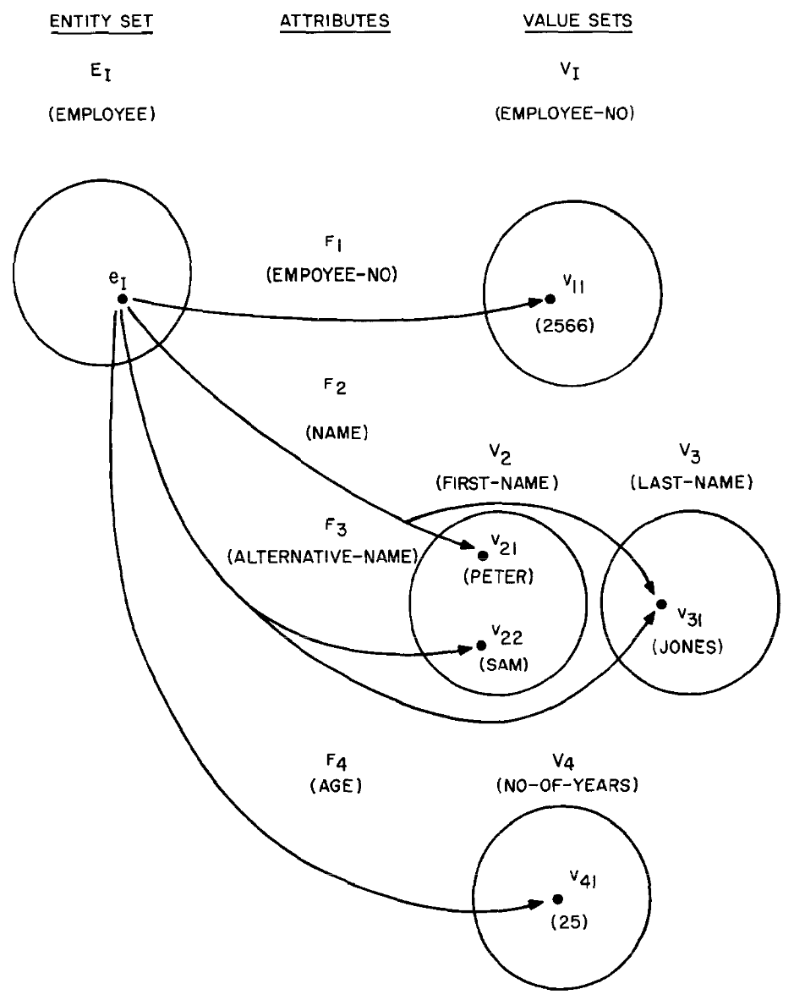

  * AGE: EMPLOYEE -> NO-OF-YEARS, NAME: EMPLOYEE -> FIRST-NAME $\times$ LAST-NAME, EMPLOYEE-NO: EMPLOYEE -> EMPLOYEE-NO
  * More than one attribute may map from the same entity set into the same value set
  * Attribute maps a given entity to a single value

* A set of entities of the same type is termed an entity set

  > e.g. football teams, students

  * If we know an entity is in the entity set EMPLOYEE, then we know that it has the properties common to the other
    entities in the entity set EMPLOYEE.
  * Entity sets may not be mutually disjoint (e.g. entity belongs to MALE-PERSON also belongs to PERSON)

**[Relationships]**

* Relationships of the same type are contained in a **relationship set**.

* If $E_1, E_2, ...E_n$ are entity sets, then a relationship set $R$ is a subset of $\{[e_1, e_2, ..., e_n]|e_1\in E_1, e_2\in E_2, ... e_n\in E_n\}$ where $[e_1, e_2, ..., e_n]$ is a relationship (the relationships that truly exist may only be a part of all the possible matches).

* Binary/ternary/... relationship:

  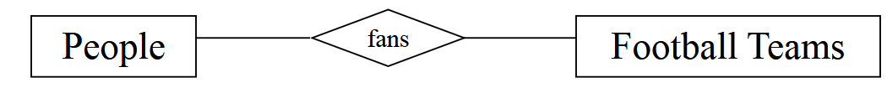

  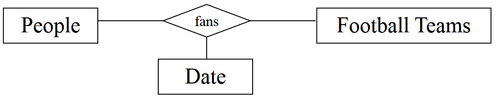

  The above relationship can also be represented as:

  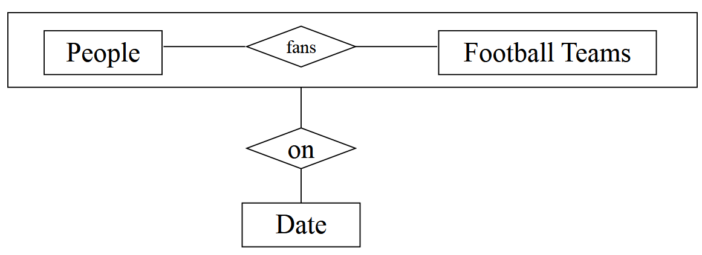

  Binary relationships can have number constraints (**cardinality**):

  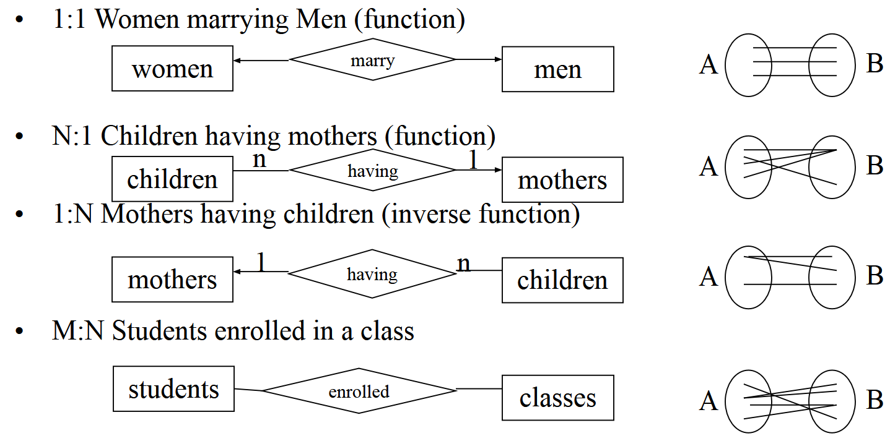

* Double lines mean an entity must participate in a relationship (people must be fans of football teams):

  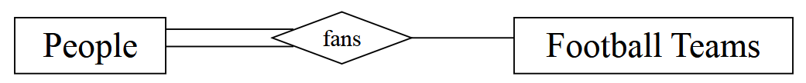

* Relationships also have attributes (PERCENTAGE-OF-TIME):

  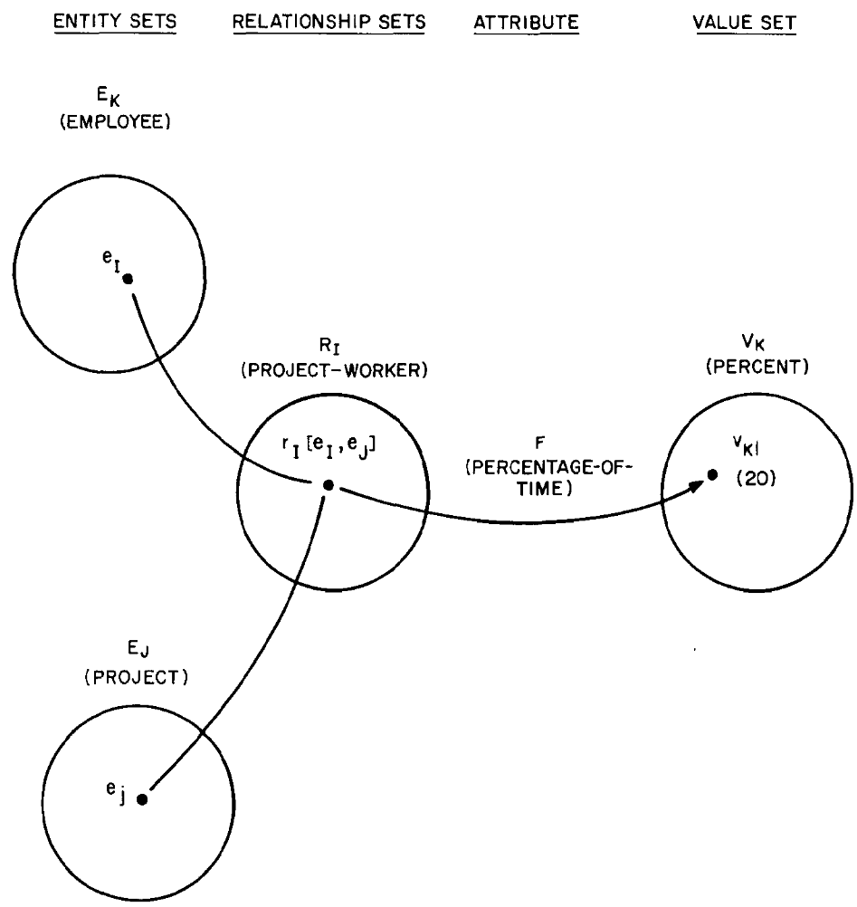

### Key

* Level 2 (representations of conceptual objects)
* A combination of one or more attributes

#### Key concepts

* **Primary key**:  a candidate key that is **chosen** by the database designer **to identify the entities** of an entity set (semantically meaningful)
* **Superkey**: a key defined either for an entity set or relationship set that **uniquely identifies** an entity
* **Candidate key**: **a minimal superkey** that uniquely identifies either an entity or a relationship
* **Foreign key**: a set of one or more **attributes of a strong entity set** that are employed to construct the discriminator of a weak entity set

**Functional dependency**: The values of the primary key are used to represent entities. Therefore, **nonkey value sets** (domains) are functionally dependent on **primary-key value sets**.

#### Keys in relationships

Since a relationship is identified by the involved entities, the primary key of a relationship can be represented by *the primary keys of the involved entities*. 

If relationship $R$ is a relationship set involving entity sets $E_1, E_2, ...E_n$. If $R$ has no attributes then its superkey (uniquely defines...) is: $primary-key(E_1)\cup primary-key(E_2)\cup ...\cup primary-key(E_n)$

If $E_1 \rightarrow E2$ is many to one, then $R$'s primary key: $primary-key(E_1)$

#### Weak v.s. strong entity sets

* An entity set that **does not have sufficient attributes to form a primary key** is termed a *weak* entity set. An entity set that has a primary key is termed a *strong/regular* entity set.
*  A weak entity set must be associated with an **identifying or owner** entity set.
  * The identifying entity -> owns the weak entity set that it defines
  * **Identifying relationship**: the weak entity set <-> the identifying entity set
  * weak entity set (one/many) ->  the identifying entity set

## Diagram & Inclusion of Semantics

### E-R diagram

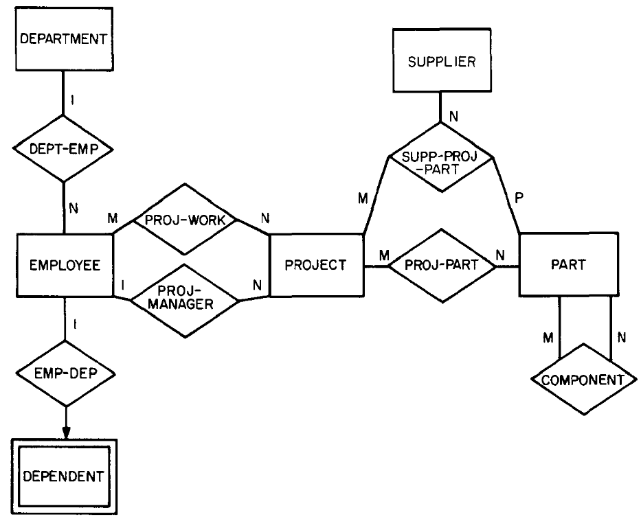

* regular box - entity set (existence dependency -> double line: weak entity)
* diamond-shaped box - relationship

#### Reduction to tables (relations)

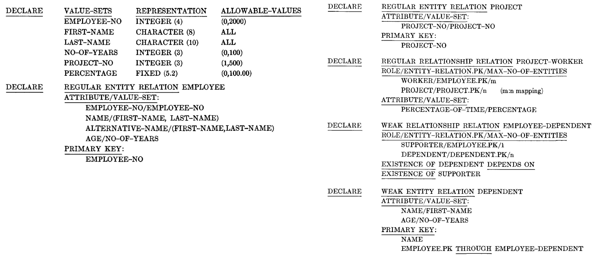

### Semantics

#### Data Integrity Constraints

* Allowable values: constraints from the value sets
* Permitted values: a number might be allowed in a value set, but not for a certain attribute (e.g. the age of employees range from 20 to 65)
* Existing values: 
  * Constraints between sets of existing values, e.g. $$ \{\, NAME(e) \mid e \in MALE\text{-}PERSON \,\} \subseteq \{\, NAME(e) \mid e \in PERSON \,\} $$
  * Constraints between particular values, e.g. $$ TAX(e) \le SALARY(e),\quad e \in EMPLOYEE $$

#### Functional Dependency

An attribute Y is functionally dependent on attribute (or set of attributes) X if it is invalid to have two records with the same X value but different Y values. A given X value must always occur with the same Y value. ($X\rightarrow Y$)

If X is the **key** of a relation then all other attributes of a relation are by definition **functionally dependent** on X.

**Two major types** of functional dependency:

1. Functional dependencies related to **description of entities or relationships**. **Nonkey value sets** (domains) are functionally dependent on **primary-key value sets**.
2. Functional dependencies related to **entities** in a relationship. For example, PROJECT-MANAGER is a 1:n mapping.

#### Normalization

* The process of replacing un-normalized records with normalized records is termed normalization
* Advantage : it enhances the **integrity** of data by minimizing redundancy and inconsistency
* Disadvantage: performance might be lost. For example, the execution of the following query **now requires the execution of a join operator**: Retrieve the address of all warehouses that contain part-id=5.
* Normalization applies to level 2 (representation of conceptual concepts)

> **1NF** requires a relation to have **atomic attribute values**: no repeating groups, no nested tables, and no sets or lists in a single cell. After 1NF, every row is a flat tuple of single values.
>
> **2NF** applies to relations already in 1NF. It forbids a non-key attribute from **depending on only part of** a composite key. In other words, every non-prime attribute must be fully functionally dependent on the whole candidate key, not on a subset of it.
>
> **3NF** applies to relations already in 2NF. It forbids a non-key attribute from depending on another non-key attribute. More precisely, every non-prime attribute should depend only on a candidate key, not through a **transitive dependency**.

## Other Data Models

### The relational model

Relation, $R$, is a mathematical relation defined on sets $X_1, X_2, ...,X_n$

$$ R = \{\,(x_1, x_2, \ldots, x_n) \mid x_1 \in X_1,\ x_2 \in X_2,\ \ldots,\ x_n \in X_n\,\} $$

$X_1, X_2, ...,X_n$ -- domains, $(x_1, x_2, \ldots, x_n)$ -- tuples

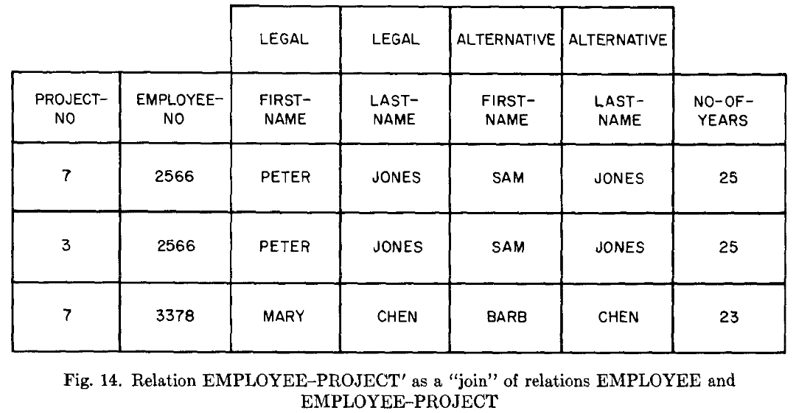

* Ambiguity in semantics: In ER-model, attributes are bounded to entity/relationship. However, in the relational model, there might be **domains with the same name in the same relation**. And relational operators in relational model may also cause ambiguity. For example, both EMPLOYEE and SHIP has a **domain** called NO-OF-YEARS. But joining EMPLOYEE and SHIP on this domain produces no meaning in reality.
* In the relational model, “attribute” B of a relation is functionally dependent on “attribute” A of the same relation if each value of A **has no more than one value of B associated with it** in the relation.
* Compared with the relational model, by using the ER model we can arrange data in a form similar to 3NF relations but with clear semantic meaning.

### The network model

Network model is the semantics of a **data structure diagram**. Each of its rectangular box represents a record type.

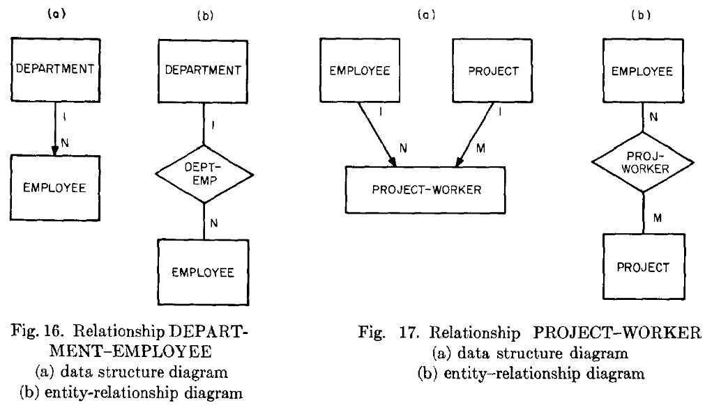

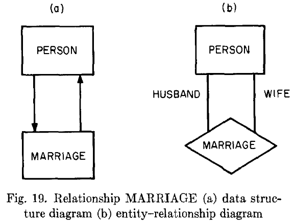

* For 1:n binary relationships -- an arrow
* For m:n binary relationships -- a "relationship record" type is created (Fig. 17a)
* For k-ary (k >= 3) relationships, the same as above

**Disadvantages**: Arrows in a data-structure diagram do not always represent relationships of entities. The network model is awkward in handling changes in semantics.

### The entity set model

Entities have names (**entity names**) such as “Peter Jones”, “blue”, or “22”. Entity names having some properties in common are collected into an **entity-name-set**, which is referenced by the **entity-name-set-name** such as “NAME”, “COLOR”, and “QUANTITY”.

An entity is represented by the **entity-name-set-name/entity-name** pair such as NAME/Peter Jones, EMPLOYEE-NO/2566, and NO-OF-YEARS/20 (ambiguity between "entities" and "attributes").

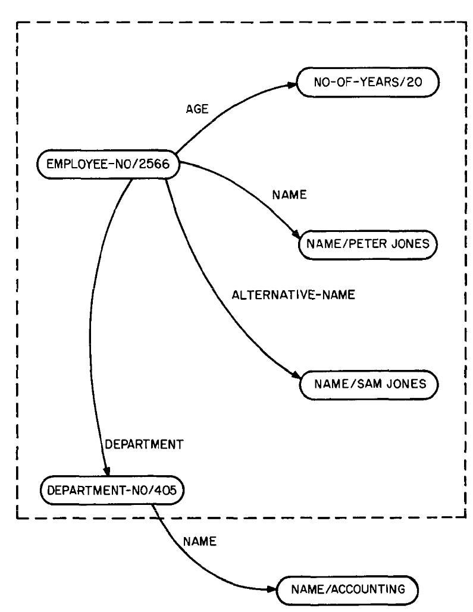

**Differences from ER-model:**

* In the entity set model, everything is treated as an **entity**, instead of a **value**. The difference between, for example, "NAME/Peter Jones", "NAME/Sam Jones", and "EMPLOYEE-NO/2566" can be ambiguous.
* The entity set model can only describe binary relationships.

